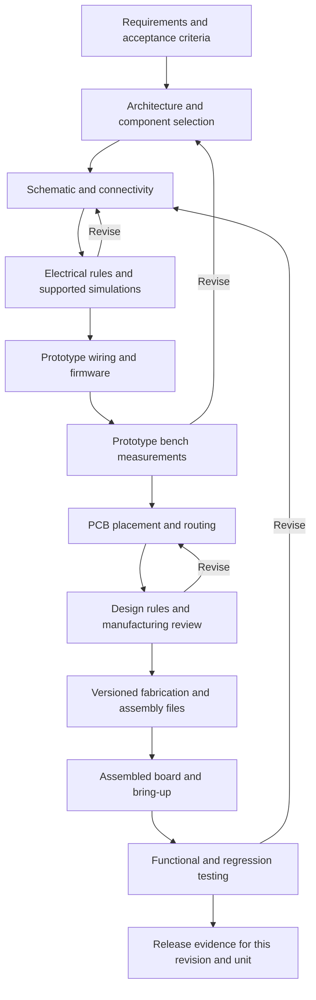

# Electronics Build and Test plan

Status: roadmap, 2026-10-11. The user asked for Build to cover the capabilities of https://www.blueprint.io/ and, in future, a workflow from schematics through testing, wiring, PCB design, and further testing. The first saved-file KiCad adapter is now implemented: project import, SVG previews, real ERC/DRC and fabrication exports were tested on Linux. See [the implemented scope](KICAD-INTEGRATION.md). Circuit generation, simulation, wiring guidance, firmware and physical testing remain future work.

## Scope and evidence

Treat these as two related requirements:

1. Analyze Blueprint.io and translate its verified workflows and deliverables into a concrete Build capability target.
2. Extend the assistant to electronics and combined hardware/firmware projects, with checks throughout the design-to-test process.

Blueprint.io is a public product reference. Its relationship to the user's local `E:\blueprint-backend` is unknown. Neither the site's capabilities nor that local repository's implementation should be inferred from their shared name.

The current cloud proxy blocks both Blueprint hostnames with HTTP 403 at CONNECT. Only those two hostnames were added to the existing environment network draft; saving that draft has not established runtime access. The website assessment remains blocked until access is available. The electronics workflow below is our proposed response to the user's requirement, not a description of verified Blueprint features.

The access observations and comparison checklist are saved in [Blueprint.io source findings](docs/research/BLUEPRINT-ACCESS.md). Once accessible, inspect its supported inputs, creation/editing loop, generated artifact types, test/preview environment, ownership/export, integrations, pricing limits, and examples. Classify each feature as a documented claim, demonstrated workflow, or personally tested behavior before mapping it to our backlog. Do not assume that the public product offers an API, open-source code, or electronics tooling.

## Product shape

Keep the same four modes and shared project history. A project can contain software, electronics, or both; it should not require separate assistants with disconnected memories.

| Mode | Electronics responsibility |
| --- | --- |
| Brainstorm | Turn a device idea into requirements, operating conditions, interfaces, power/cost/size constraints, and measurable acceptance criteria. |
| Daily | Track decisions, missing information, parts to source, design revisions, prototype work, and next experiments. |
| Build | Produce and revise component selections, schematics, wiring/assembly instructions, board files, firmware, and release artifacts. |
| Test | Run applicable checks and simulations, validate firmware, guide bench procedures, and retain measured evidence for the exact design and unit. |

Build should expose real editable artifacts alongside the conversation. Proposed desktop views are Requirements, Parts, Schematic, Wiring, PCB, Firmware, and Releases. Test presents rule-check reports, plots, firmware results, and bench records with links to the affected component, net, file, or requirement. These are planned views within the existing shell, not a new approved visual design.

## Workflow and deliverables

Prototype wiring is a useful route, not mandatory for every board. Some projects can proceed from validated schematic blocks to PCB while retaining the same requirements and evidence. Simulation, rule checking, and physical measurements remain separate activities throughout.

Firmware develops alongside the hardware stages. Pin/interface contracts connect the schematic, prototype firmware, board revision, and final integration tests; firmware should not be deferred until after manufacturing.

| Stage | Editable output | Acceptance evidence |
| --- | --- | --- |
| Requirements | Versioned brief; supply, interfaces, operating conditions, budget, size, test limits. | Each requirement is measurable or explicitly unresolved; assumptions are visible. |
| Parts and architecture | Block diagram, candidate BOM, datasheet references, part numbers, pin functions, package/footprint choices, power budget. | Pin mapping, voltage/interface compatibility, ratings and package verified against cited sources. Availability/prices carry timestamps if fetched. |
| Schematic | Native KiCad project/schematic, stable component/net identities, selected libraries, readable preview, exported connectivity. | Opens in pinned KiCad; electrical rule report recorded; warnings/exclusions documented. A clean ERC is not proof of correct behavior. |
| Simulation | Netlist, supported device models, model provenance, stimuli, conditions, expected limits, plots/raw outputs. | Applicable DC/AC/transient analyses converge and meet named limits. Unsupported devices/behaviors are marked untested. |
| Wiring and prototype | Connector pin tables, from/to wire list, harness/breadboard instructions where supported, assembly checklist, firmware pin map. | Connector numbering/orientation and voltage-domain consistency checked; continuity and prototype measurements recorded separately. |
| PCB | Native board, outline/stackup, placement/routing constraints, footprints, clearances, test points, 2D/3D previews. | Schematic/board connectivity compared; board DRC and unresolved items recorded; mechanical and fabrication constraints reviewed. |
| Fabrication/assembly | Versioned Gerbers, drill files, BOM, placement data and assembly drawings as appropriate to the chosen fabricator. | Bundle hashes, complete layer/unit/origin settings, side/orientation conventions, selected variant, release review. Export success alone is insufficient. |
| Firmware | Source, pin definitions, build configuration, reproducible binary, flashing procedure. | Compile and meaningful host/device tests; target and binary hash recorded. Firmware compilation does not validate the board. |
| Bring-up | Unit identity, assembly inspection, continuity checks, procedure, power/current observations, interface checks. | Real readings with limits and equipment/procedure context; manual entries labeled as reported measurements. |
| Regression/release | Requirement-to-result matrix, unresolved issues, per-revision/per-unit evidence bundle. | Required checks pass or have explicit documented dispositions; no reuse of stale results as current evidence. |

## Integrate established engineering tools

The user specifically requested interfacing with KiCad. [KICAD-INTEGRATION.md](KICAD-INTEGRATION.md) defines project linking, saved-file synchronization, CLI jobs, and a later capability-gated live editor bridge as the preferred approach.

Use KiCad as the initial editable schematic/PCB format and CAD application. Use its supported CLI for applicable checks and exports, pinned to a tested version. Start with importing and reviewing real projects and generating small constrained designs from vetted templates/libraries. Do not promise a general natural-language-to-correct-PCB engine as the first milestone.

The initial app should preview and inspect artifacts, propose bounded edits, open them in KiCad, and import subsequent changes. Full interactive schematic editing, board placement, and routing stay in the CAD tool until there is a justified, tested integration. A command-line export tool is not automatically an autorouter, schematic synthesizer, or round-trip editing API.

Use ngspice for supported circuit analyses. An MCU or complex digital sensor does not acquire a valid SPICE model because its schematic symbol exists. Record model coverage, assumptions, and unsupported behavior; isolate analog/power blocks when full-system simulation is unavailable. Digital/firmware simulation requires separate target-specific tools if later needed.

Choose one firmware toolchain for the first supported project, then add adapters. PlatformIO, vendor SDKs, serial test harnesses, and instrument libraries such as PyVISA are candidates to evaluate, not dependencies already selected or installed. Support instruments by explicit model/protocol capabilities rather than promising every USB or network device.

Human-reviewed wiring diagrams must be grounded in the same connectivity as the schematic. They are not decorative AI illustrations. Native schematic/board files remain editable and authoritative; generated previews are derived artifacts.

## Shared architecture

Reuse the coordinator, Windows worker, API client, and task ledger from the desktop/mobile plan. Add capability-specific worker adapters for CAD, simulation, firmware, and supported instruments. The React renderer and Android client submit typed project operations and render results; they do not receive unrestricted shell/device access.

Keep domain records distinct:

- **Project/requirements:** stable IDs and versioned acceptance criteria shared by software and hardware.
- **Design revision:** schematic, board, netlist, libraries, BOM and assembly variant, wiring, firmware and test-plan references.
- **Artifact:** native or derived file, content hash, parent inputs, tool/version, creation action and provenance.
- **Run/result:** requested operation, exact inputs, environment, parameters, command/adapter version, timestamps, logs, result and limitations.
- **Physical unit:** board revision, assembly variant, serial/lot, rework history and installed firmware. Two boards made from the same files are still different units.
- **Measurement:** requirement, unit, procedure version, instrument/fixture identity and relevant settings, units/limits, raw readings, outcome, and whether instrument-captured or manually reported.

Build an explicit dependency graph. A pin change can invalidate wiring, board connectivity, firmware pin definitions, and relevant tests. A new footprint invalidates layout/release review even if the netlist is unchanged. A source change invalidates checks that depended on that source. Preserve earlier evidence as historical; mark the current coverage incomplete until affected checks run again.

For uncertain dependency coverage, conservatively mark the related review/test group stale. Do not present an inference about unaffected behavior as a new successful measurement.

## Test semantics and physical work

Every result names what was checked: electrical rules, board rules, simulation, firmware test, fabrication review, or bench measurement. Show Passed, Failed, Not run, Blocked, Stale, and any explicit waiver at the individual check level. A finished worker task only means the operation finished; it does not imply the entire device is verified.

For bench testing, show the selected physical unit and connected instrument before an action. Begin with guided procedures and read-only acquisition where available. Manual measurements are acceptable evidence when clearly labeled with their source. Any later instrument control or flashing must target an identified device and an explicit operation; a task retry must not blindly repeat a physical side effect.

If a connection drops during a physical operation, record its outcome as unknown until reconciled. Keep emergency/local stop behavior in the instrument/worker design; a phone network link cannot be the only stop mechanism. This is an architecture requirement for future equipment integration, not a claim that instrument control exists now.

Ordering boards/parts, programming a device, energizing a circuit, and publishing a release are explicit actions outside this planning task. Producing a reviewed fabrication bundle is a separate deliverable from submitting an order.

## Android companion

Preserve the confirmed Android-first, Windows-companion approach. On the phone, capture ideas and assembly notes, review BOMs and connection tables, zoom into schematic/board previews, inspect test results, and follow one step of a bench checklist at a time. Camera attachments or instrument readings require their own implemented and tested integrations.

Windows remains the initial CAD, simulation, firmware, and instrument host. With it unavailable, the phone shows cached reports and keeps local drafts. A cached passing result must show its revision/unit/time; it is not a fresh test. Precise placement/routing remains a desktop workflow in the first releases.

## Delivery sequence

1. **Blueprint assessment and general builder definition.** Once its public pages are reachable, record the product's actual inputs, interaction loop, editable outputs, validation, export, integrations and limitations. Translate verified features into independently scoped acceptance criteria; do not assume source/API access or a reuse license.
2. **Engineering project foundation.** Add requirements, artifact versions, part references and distinct test-result types to the shared project model. Import one existing KiCad project, show its contents, run a real rule check, and link a known diagnostic back to the design.
3. **Schematic and simulation slice.** Support a small vetted design family. Propose a bounded schematic change, open it in KiCad, export connectivity, run applicable rule checks and a supported simulation, and mark uncovered behavior honestly.
4. **Wiring and firmware slice.** Generate connector/wire tables from the same nets, compile a pinned firmware example, and produce a guided prototype test procedure. Capture a first real measurement only when the user has the board/equipment available.
5. **PCB and manufacturing slice.** Assist with a simple two-layer board, verify schematic/PCB synchronization and DRC, review mechanical constraints, and export a complete revisioned fabrication/assembly bundle. Placement/routing may be manual or tool-assisted; autonomous routing is a later capability to prove.
6. **Bench and regression slice.** Support selected instruments and a repeatable fixture/procedure; connect measured results to individual boards, firmware and requirements. Add change-impact analysis and repeat tests after a controlled revision.

Proposed first reference project: a low-voltage microcontroller-module and sensor carrier board with a small BOM, two-layer PCB, explicit connector pinout, simple firmware, and measurable supply/interface behavior. This is an illustrative scope recommendation; no hardware has been selected, ordered, powered, or tested. Simulate only supported subcircuits rather than implying a complete microcontroller simulation.

## Acceptance scenarios

- An intentional schematic fault appears in the imported electrical-rule report; the app cannot call the design verified merely because the command exited.
- An incorrect connector pin assignment is caught by connectivity/pin-map checks or fails an explicit review; it is not silently copied into wiring instructions.
- A simulation that fails to converge or lacks a required model is Blocked/Failed, never Passed.
- A board mismatch or rule violation appears in Test and prevents the project's configured release gate from silently passing.
- A schematic, footprint, BOM variant, firmware or test-plan change invalidates the appropriate downstream evidence.
- A fabricated unit has its own results; a pass on unit A cannot become a measurement for unit B.
- A phone retry does not duplicate a CAD job; physical operations use stricter reconciliation instead of blind retry.
- A release export contains the chosen revision's actual fabrication files and manifest; it is not called manufactured or bench-tested.

## Outstanding validation

Blueprint's public product capabilities and the local Blueprint backend remain uninspected. Tool versions, automation interfaces, model/library licensing, Windows packaging, supported instruments, and actual device behavior require validation during implementation. The plan does not establish unattended end-to-end hardware design or physical test capability.

## Verified automation reference

Official [KiCad 9.0 CLI documentation](https://gitlab.com/kicad/services/kicad-doc/-/blob/152cd19e879b6ce33b85c5bba51ef19581df8a6b/src/cli/cli.adoc) was inspected at commit `152cd19e879b6ce33b85c5bba51ef19581df8a6b`. This is a documented capability baseline, not a claim that 9.0 is the latest release or that these commands have been run here.

| Operation | Documented command family |
| --- | --- |
| Identify installed version | `kicad-cli version` |
| Electrical rule report | `kicad-cli sch erc --format json --exit-code-violations` |
| Board rules and schematic comparison | `kicad-cli pcb drc --format json --schematic-parity --exit-code-violations` |
| Bill of materials | `kicad-cli sch export bom` |
| SPICE connectivity export | `kicad-cli sch export netlist --format spice` |
| Fabrication layers/drills/placement | `kicad-cli pcb export gerbers`, `pcb export drill`, `pcb export pos` |

The examples identify command families/options only; adapters must supply validated inputs and explicit output paths. With `--exit-code-violations`, the documented rule-check outcome uses exit code 5 for violations and 0 for no violations. Capture and parse the report, severity selection, excluded findings, and operational errors; a successful process exit without the relevant options is not a sufficient quality gate.

Verify the installed version and available subcommands before enabling an adapter. Do not borrow newer API or headless-editing promises from development documentation and assume they work in this baseline. Exports must specify output locations and a versioned fabrication profile, including layer set, units/origin, drill configuration and component-population rules.

KiCad source/docs were inspected by an independent agent. No EDA executable, circuit simulation, CAD GUI, manufacturing bundle, firmware flash, or bench measurement was run. ngspice, firmware and instrument adapters remain implementation proposals that require their own documentation and runtime validation.
