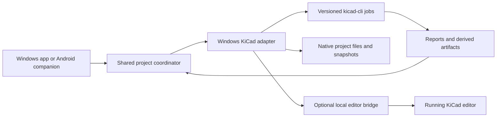

# KiCad interface

Status: the saved-file MVP is implemented and tested against actual KiCad CLI 9.0.2 on Linux. It connects native projects, generates schematic/board SVGs, runs ERC/DRC with schematic parity when available, and exports Gerbers, drills, BOM and placement CSVs with evidence. Native Windows launch/install checks remain outstanding. Live editor APIs and Android are future stages described below.

## Intended experience

Connect an existing KiCad project from Build, inspect its schematic/board and parts, open it in KiCad for editing, then return to updated previews and check results. The assistant explains problems and proposes changes using the same project context. Test retains the actual rule reports and their source revision.

Validated fixture workflow: connect a project → generate and display real SVG previews → run clean ERC/DRC → export fabrication files → alter a trace externally → refresh → mark earlier evidence stale → show actual failed DRC. Launching the interactive KiCad editor on Windows and manually fixing a real user design remain native acceptance tasks.

KiCad remains the full CAD editor. The app provides the project workspace, conversation, previews, automation and evidence. Launch KiCad as its own desktop window; do not depend on embedding or reparenting its native window inside Electron.

## Three integration levels

| Level | Interface and status | Boundary |
| --- | --- | --- |
| 1. Project and files | Implemented selection, matching schematic/board discovery, editable project brief, saved-file refresh, previews, and native editor launch command. | Reads saved disk state. It cannot see unsaved edits. Windows native launch still requires validation. |
| 2. Command-line jobs | Implemented ERC/DRC, schematic parity, previews, BOM, Gerber/drill and placement exports. Standalone netlist export remains future work. | Commands/flags are capability checked against KiCad 9+. Jobs run on bounded snapshots with hashes and exact command evidence. |
| 3. Live editor bridge | Use supported KiCad IPC APIs for editor context and bounded changes where available. A local adapter may use the official Python client. | Capability-gated by version/editor. Do not promise full live schematic and PCB automation merely because an IPC connection exists. |

Levels 1 and 2 form the first useful release. Level 3 is a separate capability milestone; it is not a prerequisite for imports, previews, checks, or manufacturing exports.

## Application boundary

The worker discovers or accepts the local executable paths, checks the installed version/capabilities, and reports Not installed, Available, Busy, or Unsupported version accurately. Keep the KiCad GUI and CLI installation identities consistent. Validate Windows discovery and launch behavior on Windows; this Linux cloud session cannot establish it.

Expose typed operations such as inspect project, refresh preview, run electrical checks, run board checks, export fabrication bundle, and open in KiCad. The coordinator uses project IDs; the worker resolves approved paths and runs bounded commands with argument arrays. The UI and phone do not supply arbitrary shell command strings.

The phone can inspect previews, review findings and request supported checks while the PC is reachable. Interactive CAD editing initially remains on Windows. Editor IPC stays local to the worker; it is not exposed directly over the phone connection.

## Saved state, changes and results

- Current MVP observes saved-file changes on refresh and before/after jobs, marking prior results stale. Automatic filesystem watching is future work. Save in KiCad and refresh in JaxOS before relying on current results.
- Run checks/exports on a coherent snapshot of the required saved files and dependencies; record hashes, tool version, flags and selected configuration. Detect input changes during capture and retry or request a fresh save rather than mixing revisions.
- Keep generated reports and exports in run-specific output directories. Do not let default command paths overwrite or scatter generated outputs beside source files.
- Display electrical-rule and board-rule results separately. Capture severity choices, exclusions, report content and process status. Preserve warnings and explicit waivers.
- Proposed AI edits become a visible change set against a known source version. Detect external/unsaved-editor conflicts before applying or reloading files; retain the original and support undo/recovery. Do not silently overwrite a user's KiCad changes.
- Begin with template-based or narrowly scoped edits that can be reopened and checked. General schematic generation, placement and routing need separate proof; CLI checks/exports do not establish those capabilities.
- Simulation is another job type with explicit models and limits, not an automatic consequence of a schematic opening successfully.

## First milestone and validation

Connect one real existing KiCad project and complete: inspect → open in KiCad → save → refresh preview → run ERC/DRC → inspect reports → export a selected artifact set.

The desktop tests cover clean and intentionally faulty fixtures, report integrity and hashes, missing/unsupported tools, paths with spaces, stale state after external changes, preserved source files, cancellation and export contents. A four-layer fixture verifies internal copper export; schematic/board disagreement blocks fabrication. Gerber job references must resolve in the exported bundle. See [validation](docs/VALIDATION.md). Android reconnect is a later acceptance gate.

The adapter rejects symlinks, remote database libraries and custom dependencies outside the project root. Jobs are bounded to 2,000 files, 128 MiB total input, 32 MiB per file and a 120-second process timeout. These are deliberate MVP limits, so unusual projects may need dependencies copied into their project folder or a later adapter extension. ERC/DRC findings, including warnings, block fabrication. Exports preserve the output directory structure and include both the KiCad evidence manifest and a portable run summary.

## Official capability baseline

The previously inspected [official KiCad 9.0 CLI documentation](https://gitlab.com/kicad/services/kicad-doc/-/blob/152cd19e879b6ce33b85c5bba51ef19581df8a6b/src/cli/cli.adoc) documents ERC/DRC JSON reports, schematic parity checking, BOM/netlist exports, and fabrication exports. It is a supported planning baseline, not a claim about the latest KiCad release.

The [official KiCad 10 CLI documentation](https://gitlab.com/kicad/services/kicad-doc/-/blob/efa5960e3173ce3b40d0d219948c05692b48fc64/src/cli/cli.adoc) also documents the check/export foundation. Select and validate an installed release during implementation rather than assuming that development documentation matches it.

Independent official-source inspection established these live-connection boundaries:

- The [released official Python client, kicad-python 0.8.0](https://gitlab.com/kicad/code/kicad-python/-/blob/473a03cb4c900a9df059c04b26e66106632604bf/README.md) requires a running KiCad 9 or newer with the API enabled in Preferences → Plugins. Pin a compatible client and use its version check; do not assume every method works across every release.
- Its [Board interface](https://gitlab.com/kicad/code/kicad-python/-/blob/473a03cb4c900a9df059c04b26e66106632604bf/kipy/board.py) includes selection/item reading, item updates, saving, and undoable edit commits. Start with read-only PCB context, then bounded edits with review, undo and fresh checks.
- That released client has no schematic wrapper. [KiCad 10.0.7 schematic API source](https://github.com/KiCad/kicad-source-mirror/blob/69cafb907ebc09e7722a2a464b1d466fc2e3608d/eeschema/api/api_handler_sch.cpp) contains unfinished infrastructure, so complete live schematic editing is not a supported planning baseline here.
- The inspected [development client README](https://gitlab.com/kicad/code/kicad-python/-/blob/87b945a0d56b26a78bf547db9771ff9bf3a057ea/README.md) identifies initial schematic support as unreleased and headless `kicad-cli api-server` as requiring KiCad 11+. Keep this separate from ordinary CLI checks/exports available in 9/10.
- Windows editor endpoints are instance-specific. Use the client's supported connection discovery/configuration and keep any local connection token on the worker; do not hardcode one socket or confuse two open projects.

The live API findings above are documentation/source research, separate from the executed CLI integration. Live schematic editing and headless IPC editing are outside this MVP.
