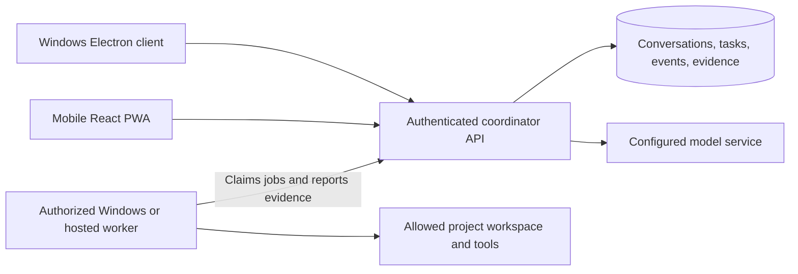

# Mobile companion plan

Status: planning only. The user requested mobile alongside the Windows Electron + React app and previously selected visual mockups before implementation. No mobile app, pairing endpoint, sync service, or installer exists yet. JaxOS remains a working name.

Confirmed scope: **Android first, Windows companion first.** Live work depends on the paired PC being awake and reachable. Preserve an eventual iPhone/hosted-worker path without adding either to the first release.

Android is explicitly deferred from the approved personal Windows MVP. References to a first release below mean the future mobile release; no pairing, synchronization, offline phone cache, or remote execution is implemented today.

## Recommended first mobile release

Keep one assistant with four modes and shared conversations, project briefs, decisions, and task evidence. Use Windows for substantial editing and local execution. Use a phone for capturing ideas, daily planning, giving a build brief, reviewing a change, and checking a run.

Future electronics projects use the same relationship: phone review of schematics, BOM/wiring tables, assembly steps, and per-unit test results; CAD and instrument work stays on Windows initially. See [ELECTRONICS-PLAN.md](ELECTRONICS-PLAN.md). These are planned extensions, not implemented phone capabilities.

Propose a responsive React PWA for the first Android release, with iPhone compatibility kept in mind for later validation. It can share browser-safe components with the desktop renderer and avoids a second UI stack while the workflows are being established. Android priority is confirmed; PWA delivery is the recommended implementation approach. Electron itself does not ship to phones.

Consider a Capacitor wrapper if the React companion needs selected native integrations or store packaging. Consider Expo / React Native if a dedicated native interface and deeper device capabilities justify a separate screen implementation. Share domain types, API contracts, design tokens, and appropriate business logic with that client; do not assume React DOM components transfer unchanged to React Native. Native mobile still does not provide unrestricted background execution.

## Four modes on a phone

| Mode | Phone experience | Execution requirement |
| --- | --- | --- |
| Brainstorm | Capture an idea, discuss it, edit a brief, keep decisions, and continue the same conversation on Windows. | Draft capture works offline. Model replies require a reachable configured model service. |
| Daily | Today list, notes, priorities, and next actions; open the relevant conversation or task. | Cached reading and local drafts work offline. Shared changes synchronize when connected. |
| Build | Choose an authorized project, submit a brief, inspect a plan or compact diff, and start/cancel a supported job. | Repository operations run on the project's available worker. Full editing remains a desktop strength. |
| Test | Request named checks, follow progress, read failures, and inspect the tested revision and results. | Checks run on the worker. The phone displays recorded evidence. |

Calendar access, microphone transcription, notifications, file attachments, and an operating-system share extension are separate integrations. The first release must not imply any of them already works.

## Mobile composition

Carry over the selected desktop typography, pale surfaces, restrained blue accent, and conversation hierarchy. Do not shrink the desktop's three columns into a phone viewport.

- A bottom navigation bar contains Brainstorm, Daily, Build, and Test. Each destination preserves its own state.
- The top bar identifies the selected project and its connection status; project/session switching opens a sheet.
- Brainstorm shows one conversation and a keyboard-safe composer. Its brief and saved decisions open on a separate screen or sheet.
- Daily starts with today's priorities and one obvious capture action. Selecting a row resumes the relevant context.
- Build starts with active work and a clear job state. A task detail screen exposes its brief, plan, changes, and actions progressively.
- Test starts with the latest available runs. A result exposes the command, exit status, revision, summary, and expandable logs. Long code/log lines may scroll horizontally inside their own panel.
- Touch targets should be at least 44 CSS pixels, text should tolerate system scaling, and actions must work without hover. Honor safe areas, reduced motion, and the on-screen keyboard.
- Show whether a screen is live or cached and when it was last synchronized. Use plain states such as Worker offline, Queued, Running, Failed, Canceled, and Not run.

The next mockup set should extend the chosen desktop direction with three phone views: a brainstorming conversation, Today, and a build/test task detail. Include disconnected and failed-check states in the design review. This is a follow-on deliverable, not a claim that those images already exist.

## Shared service and execution

Desktop 0.2.0 now has a coordinator isolated from Electron main, transport-independent domain logic and explicit tray continuation. Its current transport is private parent/child IPC, with snapshot reconciliation. Version 0.3.0 adds transactional task/event records, cursor queries and idempotent admission for chat/KiCad/model jobs, but no network replay or phone transport. The authenticated network API, pairing, mobile cache and separate remote worker shown below remain planned. See [current architecture](docs/ARCHITECTURE.md).



The coordinator owns durable session and task state. UI windows render that state; they do not own jobs. A worker receives bounded operations for an authorized project, executes them, and reports structured results. Hermes, OpenCode, and any future Blueprint integration sit behind versioned adapters. Do not make each adapter a competing task database.

Mobile selects an authorized project by ID. Only the worker resolves that ID to a local filesystem path such as `E:\blueprint-backend`; a phone cannot submit an arbitrary host path.

Keep the coordinator domain independent of Electron and add a separately deployable execution worker when required. The current desktop launches a coordinator child process and offers explicit tray mode; closing/hiding the window then preserves work, while Quit stops it. This does not provide an independently installed Windows service or remote phone access.

Proposed boundaries, not a scaffold already created:

```text
apps/desktop           Electron main/preload and React renderer
apps/mobile-web        Responsive React PWA
services/coordinator   Auth, sessions, tasks, synchronization, adapter contracts
services/worker        Authorized project operations, command execution, evidence
packages/domain        Typed records, states, and validation
packages/client        Versioned API client and reconnect behavior
packages/ui-web        Browser-safe shared React components and tokens
```

Start with a single coordinator and an embedded database on one host; choose the implementation after the Blueprint audit. Do not introduce multi-master database replication for the first release.

## Availability and connection options

| Deployment | What works with the Windows PC off | Tradeoff |
| --- | --- | --- |
| Windows companion first | Cached reading and local phone drafts only when Windows hosts the entire service. | Smallest first release. Live chat, sync, and local execution require the PC to be awake and reachable. |
| Always-on coordinator/model access, Windows worker | Live chat and shared planning can continue; Windows-only builds remain unavailable. | Requires another trusted host and authenticated remote access. |
| Always-on coordinator plus hosted worker | Chat, planning, and compatible builds/tests can continue. | Requires hosting and an authorized checkout/secrets policy. Tests requiring Windows need a Windows worker. |

The user selected the first row: Windows companion first. Start with Android. Keep service boundaries that permit an iPhone client or hosted worker later; neither hosting purchases nor publication is part of this plan.

Private network access is the recommended first pairing path. A phone should reach a TLS-enabled authenticated application endpoint through a deliberate private-network setup. Being on the same Wi-Fi alone does not make desktop localhost accessible, and PWA installation/service-worker features require a secure context. Do not expose Electron debugging, raw shell control, or an unauthenticated model endpoint to the internet. A relay can be evaluated later without changing client domain contracts.

## Synchronization and task behavior

- Each conversation, message, project, and task has a stable server identifier. Commands carry idempotency keys; a phone retry must not create a second build.
- Save a task transition durably before publishing its event. Clients resume from a last-seen event cursor or refresh a snapshot when the cursor is no longer available; a streaming connection alone is not persistence.
- Message appends are ordered by the service. Editable briefs use version checks; concurrent edits should request resolution rather than silently overwrite work.
- Cache a bounded amount of recent, non-secret display data. Save drafts locally, offer clearing cached data, and show which content is unsynchronized. Log truncation must be visible.
- Offline capture does not silently become an execution request later. When connectivity returns, synchronize draft content and ask the user to send or run it deliberately.
- A draft is shown as Saved on this phone until acknowledged by the coordinator. Queued means the coordinator durably accepted a job; a disconnected phone cannot promise that state.
- Use a small explicit task lifecycle: queued, running, awaiting input, succeeded, failed, canceled. A disconnected worker is a separate liveness condition. Do not label a task failed merely because the phone lost its connection, or retry an uncertain process automatically.
- A cancellation request remains pending until the worker acknowledges it. Reconnection should reconcile the same task instead of submitting another one.
- A build finishing does not mean tests passed. Test evidence records the command, working directory, start/end times, exit code, runner/environment, log or artifact references, and source revision plus a working-tree fingerprint if dirty. Changed source makes old evidence visibly stale.

## Device trust

Pair a phone with a short-lived single-use code/QR flow and approval from an already trusted desktop. Display paired devices and allow revocation. Use transport encryption and authenticated, expiring sessions. For the browser client, prefer an HttpOnly/Secure session cookie and explicit CSRF/origin defenses; do not keep provider keys or a permanent bearer credential in localStorage. Native clients can use the OS credential store if introduced.

Provider credentials stay with the service/worker that needs them. The renderer and phone receive capabilities and results, not unrestricted machine access. Authorize project access at the service, constrain work to the chosen workspace, and require an execution policy for commands. Any explicit approval should apply to the specific task operation and source version; changing the operation invalidates it. Separate the authority to request a run from the authority to install packages, publish, or deploy.

## Phased delivery and acceptance

1. **Design together.** Choose the desktop base composition, then create the mobile views within that system. Verify one-handed navigation, long conversations, keyboard behavior, offline indicators, and a failed-check result before screen implementation.
2. **Shared conversation slice.** Windows and mobile connect to one authenticated coordinator, open the same conversation, exchange messages, and retain history across service/client restarts. Unauthorized or revoked clients cannot access it. Pairing works on a real phone over the chosen secure network path.
3. **Daily use and interrupted connectivity.** Capture offline, reconnect without losing or duplicating content, resolve conflicting brief edits, and resume an event stream from saved state. No offline build draft auto-executes. Background suspension and return restore the correct view.
4. **Build and Test.** Run a bounded task on an allowed worker. Verify idempotent submission, disconnect/reconnect, acknowledged cancellation, a failing command, a successful command, and evidence tied to the correct source. Show worker-unavailable and stale-result states accurately.
5. **Distribution and optional independence.** Validate the Windows package and Android Chrome behavior on real devices. Test installability and any selected push flow separately. An iPhone release requires its own Safari/device validation later. Add an always-on host or native mobile app when the selected needs justify it.

Mobile push is optional. Platform/version and installation requirements vary, and background tabs may be suspended. The server/worker continues jobs independently; foreground refresh must recover the truth without relying on a notification. Test any chosen notification behavior on real devices before promising it.

## Decisions still open

- Specific native-only requirements, if any, that would change the PWA-first recommendation.
- The private-network and TLS setup for pairing the Android phone with Windows.
- Final product name and mobile visual approval. The desktop conversation shell and Build/Test workbench are approved and implemented.
- Blueprint APIs, storage, and worker reuse after access to `E:\blueprint-backend` is available.

## Hermes reference evidence

Reviewed official source at `97a9ae8ee55d31bebce49f1fb6b5ef775323976a` on 2026-10-11. These are source/documentation findings, not device test results.

| Hermes capability | Verified boundary |
| --- | --- |
| Telegram and other messaging gateways | A phone messaging app talks to the agent host. This is not a native Hermes mobile GUI. |
| Responsive web dashboard | Docs describe phone workspace selection and narrow-screen navigation. Chat embeds a terminal through a server PTY; native Windows dashboard chat requires WSL2 according to its guide. |
| Android/Termux | An aarch64 runtime package and Tier 2 support are documented, but the current guide says **“Termux is currently broken.”** It is not a reliable baseline for this app. |
| Native Android/iOS GUI or installable/offline/push-capable PWA | Not confirmed in the reviewed official source. We must implement and validate any such capabilities we promise. |

Pinned official sources:

- [Phone browser dashboard and Windows chat limitation](https://github.com/NousResearch/hermes-agent/blob/97a9ae8ee55d31bebce49f1fb6b5ef775323976a/website/docs/user-guide/features/web-dashboard.md)
- [Telegram integration](https://github.com/NousResearch/hermes-agent/blob/97a9ae8ee55d31bebce49f1fb6b5ef775323976a/website/docs/user-guide/messaging/telegram.md)
- [Android/Termux status](https://github.com/NousResearch/hermes-agent/blob/97a9ae8ee55d31bebce49f1fb6b5ef775323976a/website/docs/getting-started/termux.md)
- [Platform support tiers](https://github.com/NousResearch/hermes-agent/blob/97a9ae8ee55d31bebce49f1fb6b5ef775323976a/website/docs/getting-started/platform-support.md)

Full research: [Hermes mobile findings](/workspace/.analysis/hermes-mobile-reference/FINDINGS.md). The proposed companion uses normal application views and authenticated domain APIs; it does not inherit Hermes dashboard's terminal embedding or claim its mobile features as already implemented here.
