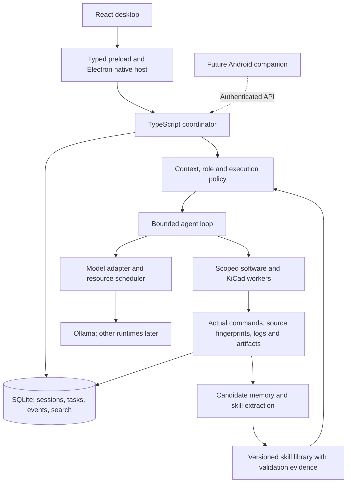

# Hermes-inspired architecture decisions

Recorded 20 October 2026 after the user's second local Hermes inspection. Continue the existing JaxOS Desktop project and its implemented 0.2.0 boundaries. The 0.3.0 update implements the persistence/task/history increment below; the tool-loop, skills and phone stages remain planned.

The Windows report is supplied evidence. Its `C:\Users\HP\...` files and full reconstruction blueprint are not accessible to this Linux workspace. Selected findings were compared against official Hermes source pinned at `97a9ae8ee55d31bebce49f1fb6b5ef775323976a`.

## Decisions

| Area | Adopted direction | Current state |
| --- | --- | --- |
| Desktop shell | Electron + React + TypeScript. Keep the approved conversation/workbench interface. | Implemented; no new shell scaffold needed. |
| Coordinator language | TypeScript/Node. Own sessions, task state, context, model orchestration and evidence in the existing coordinator. | Separate utility process implemented. Python remains available for specific future tool adapters. |
| Inference | Keep Ollama as the first runtime behind a capability-aware adapter. | Local lifecycle/profiles/reasoning implemented; more runtimes are later work. |
| Persistence | Target local SQLite with WAL, schema migrations and FTS5 for canonical history/search. Keep large artifacts as files referenced by ID/hash. | Implemented in 0.3.0 with preserved legacy JSON, online database backups and message search. |
| Agent execution | A bounded tool loop in the coordinator, dispatching named operations to scoped workers. | Planned; current chat has no tools. |
| Software builder | Git worktree per build task, inspectable changes and deterministic checks against an identified candidate. | Planned. |
| Coding engine | Preserve an optional pinned OpenCode adapter behind the coordinator's job contract. The coordinator remains the authority for accepted work and evidence. | Not installed/integrated; select and validate an engine version before wiring its API. |
| Memory and skills | Separate searchable history, curated facts, context checkpoints and versioned reusable skills. Derive candidate skills from recorded outcomes. | Planned; current history is saved, with conservative context omission only. |
| Gateway scope | Desktop first, then an authenticated Android-first Windows companion API. Telegram/Discord/Slack adapters are deferred. | No phone or messaging endpoint today. |
| Native extras | PTY/Git when needed by the builder; HUD, pets and overlays later. | Native dialogs/tray/KiCad launch already exist; PTY/Git/HUD are not implemented. |

Keeping the coordinator in TypeScript avoids introducing a second application runtime into the current Windows package. Hermes's Python implementation demonstrates the ownership boundary; it does not make Python a prerequisite for that boundary. Native simulation or instrument tools can still run through Python adapters when their libraries justify it.

## Target ownership

This is a target diagram. The [current implementation diagram](ARCHITECTURE.md) remains authoritative for implemented behavior. Electron owns window/tray/picker integration. The coordinator owns application truth and project authorization; worker processes own execution. An interactive terminal is a user surface, distinct from a deterministic job runner. A future phone addresses projects by ID; the worker resolves host paths.

## Four roles, one task ledger

| Role | Responsibility | Completion evidence |
| --- | --- | --- |
| Brainstormer | Explore options, capture constraints and turn discussion into an accepted brief. | Saved brief, decisions and acceptance criteria; suggestions remain distinguishable from facts. |
| Daily driver | Retrieve relevant context, maintain priorities and resume work across sessions. | Durable items, sourced memory and recoverable task state. |
| Builder | Plan/edit the authorized project and produce an inspectable candidate. | Worktree/source fingerprint, patch or commit, actual tool outcomes and artifacts. |
| Tester | Run declared checks against that fixed candidate and report separate outcomes. | Commands, environment/tool versions, exit codes, reports and the tested fingerprint. |

Roles are policies over the same coordinator, not four independent databases. They may share one model or resolve different model profiles. Model capability metadata is followed by task-quality checks. A tester prompt alone cannot establish independence: tests can modify files, so execution needs a disposable candidate workspace and explicit output capture. Repairs create a new candidate and require a new verification result.

## Persistence increment

Version 0.3.0 introduces the repository boundary, SQLite migration, history search and task/event/admission records described in [STORAGE.md](STORAGE.md). The remaining paragraphs retain the broader design targets, including future tool/memory records. Use one coordinator writer and transactional state/event updates. WAL permits concurrent readers; it does not provide multiple simultaneous writers or network synchronization. Keep the database on local application storage, and define a consistent SQLite backup procedure rather than copying a live database file alone.

Proposed canonical records: conversations/messages, projects, tasks/steps, tool calls/results, model profiles/operations, artifact references, memory facts, context checkpoints and skill versions. Durable events need monotonic cursors and transactionally recorded task transitions. Add idempotency keys to accepted mutating commands so reconnect can reconcile the same task. Current private-IPC sequence numbers order live snapshots only; they are not durable event cursors.

Migration must preserve the original JSON and backup. Import validated records into a new database in one transaction, retain IDs/timestamps/profile/reasoning/evidence references, verify counts and referential integrity, then record migration completion. Re-running an interrupted import must not duplicate records. Retain the old files for recovery. Probe FTS5 in the exact packaged runtime; missing/corrupt search indexes must not discard canonical history. The 0.3.0 implementation uses Electron’s built-in node:sqlite driver, probed in the actual Linux coordinator/archive. Verification on the packaged Windows coordinator remains an acceptance requirement.

## Agent and learning increments

The execution loop resolves role/model/project/policy and step/time/token budgets, builds context, streams model events, validates completed tool arguments, persists tool intent, runs the permitted operation, records its real result, and continues or stops. Never dispatch partial streamed arguments. An interrupted side effect is reconciled rather than blindly replayed. Large outputs remain artifacts with bounded context excerpts; tool-call/result groups stay together during compaction.

Begin with the existing typed KiCad check/preview/export operations and scoped project reads. Add file editing, Git and software build/test operations with recorded source identity. Run outcomes remain distinct from the model's final text. Keep OpenCode an execution adapter if introduced; its accepted-input acknowledgement or volatile event stream is not a completed job or durable evidence.

Treat learning as application knowledge management:

1. Preserve the full transcript and actual run evidence.
2. Store stable project facts with source references; create resumable checkpoints without replacing canonical history.
3. Extract a candidate `SKILL.md` with its trigger, prerequisites, steps, tool requirements, failure cases and evidence references. Successful workflows and corrected failures can both supply lessons.
4. Validate reusable steps against relevant checks, deduplicate against existing skills and retain version history before marking a candidate active. Execution permissions still apply when a skill is selected.
5. Link later uses to their outcomes so a failing/stale skill can be revised or disabled without losing its provenance.

Writing a skill does not establish that the workflow is correct. Reusing instructions is separate from model fine-tuning or guaranteed self-improvement. Background extraction should yield to interactive generation and respect local inference resource limits.

## Delivery order and acceptance

| Increment | Deliverable | Required acceptance |
| --- | --- | --- |
| Completed foundation: 0.2.0 | Isolated coordinator, typed IPC, local model controls/profiles, reasoning and tray lifecycle. | Existing 50 unit/integration and 7 real Electron passes; native Windows/GPU acceptance remains pending. |
| Completed in 0.3.0: durable task/history store | Repository boundary, JSON-to-SQLite migration, FTS search and task/event records. | Legacy import round-trip, interrupted migration retry, duplicate-command handling, crash recovery, index rebuild, packaged Windows SQLite/FTS behavior. |
| Then: bounded builder/tester | Named tool loop, scoped operations, Git/worktree candidate, separate deterministic checks. | Malformed tool calls, budget exhaustion, cancellation, uncertain writes after restart, failing/passing real checks and stale-candidate rejection. |
| Then: context and reusable skills | Checkpoints/retrieval, sourced memory, versioned candidate/active skills. | Context budget and complete tool groups, recall provenance, regression checks, skill revision/deactivation and no unsupported success claims. |
| Then: Android companion | Authenticated API, pairing/revocation, durable cursor reconciliation and phone drafts. | Real Android connection, disconnect/reconnect without duplicate jobs, revoked-device rejection and correct PC-off behavior. |

Multi-platform messaging and HUD overlays are optional later adapters. They are not prerequisites for the personal Windows builder or the Android companion.

## Evidence and qualifications

- Official [session storage documentation](https://github.com/NousResearch/hermes-agent/blob/97a9ae8ee55d31bebce49f1fb6b5ef775323976a/website/docs/developer-guide/session-storage.md) documents SQLite WAL, FTS5 and session lineage. [Schema](https://github.com/NousResearch/hermes-agent/blob/97a9ae8ee55d31bebce49f1fb6b5ef775323976a/hermes_state_schema.py) probes FTS support; [search](https://github.com/NousResearch/hermes-agent/blob/97a9ae8ee55d31bebce49f1fb6b5ef775323976a/hermes_state_search.py) includes index recovery.
- [Background review](https://github.com/NousResearch/hermes-agent/blob/97a9ae8ee55d31bebce49f1fb6b5ef775323976a/agent/background_review.py) and [agent entry point](https://github.com/NousResearch/hermes-agent/blob/97a9ae8ee55d31bebce49f1fb6b5ef775323976a/run_agent.py) corroborate configurable memory/skill review, read-before-write handling and scheduling behavior. Static inspection does not establish learning quality on the user's model.
- The supplied 260-channel count remains build/scanner-specific. Unique channel names do not establish runtime schema validation or equivalent feature completeness; see [IPC research](research/HERMES-DESKTOP-IPC.md).
- Electron supports sandboxed content, but adding a `<webview>` is not an isolation guarantee for the whole application. No embedded arbitrary web content is required for this adoption.
- Tauri/Electron artifact and memory sizes depend on dependencies, platform/runtime distribution and build settings. Fixed comparative sizes are not architecture acceptance criteria.
- [OpenCode research](research/OPENCODE-SOURCE-NOTES.md) records incompatible examples across upstream versions; integration must use one pinned, validated contract.

New source URLs/digests are recorded in [HERMES-ADOPTION-SOURCES.json](research/HERMES-ADOPTION-SOURCES.json). The 0.2.0 release artifacts remain unchanged. Version 0.3.0 implements storage/search/task admission; its evidence and limits are documented separately in [storage](STORAGE.md) and [validation](VALIDATION.md).
