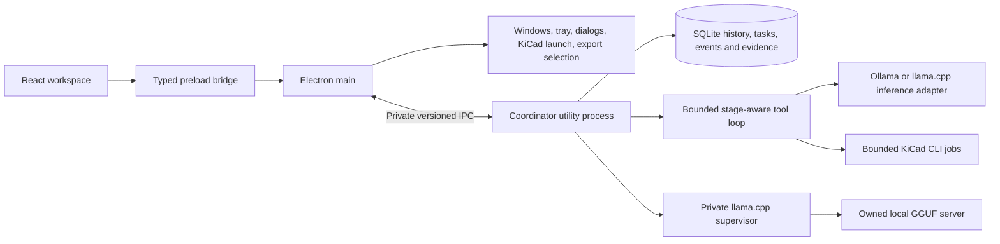

# Adopted desktop architecture — 0.4.0

The Hermes-inspired desktop combines coordinator isolation, durable SQLite tasks/history and provider-aware model management with a bounded, stage-aware KiCad tool loop. General coding-agent execution and a phone API remain later work.

## Ownership and transport

React renders state and sends typed commands. Its sandboxed renderer has no Node access. The preload exposes named operations rather than an arbitrary IPC dispatcher. Electron main owns native UI operations and starts `service-host.cjs` through `utilityProcess.fork`.

The coordinator owns conversations, Daily items, project briefs, profiles, queues, cancellation, KiCad job state and evidence. Its application logic does not depend on Electron: the same host runs through Node child-process IPC in tests. A PID lock admits one writer for the data directory. Stale locks recover only when their recorded process no longer exists; unreadable/live locks fail visibly.

The private protocol has a version, request IDs, an explicit method allowlist, bounded argument envelopes, results, ordered snapshots and a readiness handshake. `ServiceClient` rejects pending requests on process exit and never automatically replays interrupted mutations: the operation may already have saved. Reconnect starts a replacement coordinator and fetches durable state. Private IPC sequence numbers order snapshots within one connection. The repository now separately provides durable event cursors and task snapshots through typed queries; a network replay transport remains future work.

Native selection/opening remains in main; project validation and run evidence remain in the coordinator. No production HTTP/WebSocket application endpoint is exposed. Ollama and attached llama.cpp are externally owned prerequisites. Managed llama.cpp runs under a private supervisor, with ephemeral loopback/authentication and shutdown on coordinator disconnect. Runtime executables and weights are installed separately.

## Persistence and lifecycle

The workspace remains under Electron user data, normally `%APPDATA%\JaxOS\workspace` on Windows. Version 0.3.0 introduces a repository boundary and built-in SQLite driver with WAL/foreign keys/FULL synchronous commits, normalized history/run tables, task/event records and command receipts. Existing JSON and backup files are read-only import sources; transactional migration retains IDs, timestamps, profiles, reasoning and evidence references, checks counts/references and preserves the originals. An initialized SQLite database is authoritative. See [storage and restoration](STORAGE.md).

Chat, KiCad and model-job admissions commit their state and command receipt before execution. Retrying the same ID/input reconciles the existing job; conflicts are rejected. Other mutations do not yet use idempotency keys. Terminal saves commit before state publication. Streaming pushes are throttled and periodically saved; a hard crash can lose its latest unsaved fragment. Persisted nonterminal work becomes interrupted on restart and is not automatically resumed. Settings exports a consistent online database backup; artifacts and external source projects require separate copies.

By default closing the window quits. The optional tray preference hides the window instead; main and coordinator continue while the PC remains awake. Tray Quit aborts work, awaits tracked tasks, flushes state and stops the service. Parent-disconnect/liveness handling stops an orphan coordinator. This is application background mode, not a Windows service, login startup or sleep prevention. Quit stops the JaxOS-owned GGUF process. It does not stop external Ollama or an attached llama.cpp server, or force-unload their models.

## Local-model runtime

Provider adapters normalize generation frames, streamed content/reasoning, completed tool calls, usage and finish reasons. Native APIs retain provider-specific lifecycle controls. Installed weights, loaded state, advertised limits and effective context are distinct observations. Known cloud metadata is rejected for local-only requests.

Ollama retains discovery, native load/unload/pull, context, thinking and Auto/CPU policy. Managed llama.cpp validates native-selected executable/GGUF paths, probes version, launches with explicit context/CPU/layer settings and waits for health plus effective-context verification. Its supervisor owns process cleanup and ephemeral credentials. Attached mode uses loopback APIs and a session-only key without lifecycle ownership. See [runtime configuration and limitations](LLAMA-AND-WORKFLOW.md).

Profiles retain legacy Ollama keys and add llama.cpp provider/mode/model-source keys. Message admission snapshots model/profile/stage. One generation runs at a time, at most three responses can be active/queued, and one belongs to each conversation. Model lifecycle/configuration changes are blocked during active model work. These controls do not provide an exclusive lease over externally shared servers.

Unknown VRAM is not represented as zero; model-file size is not resident memory. GPU layer requests do not establish measured placement. Context/processor changes reload the owned model on its next use. Idle residency is separate from task and Windows lifetimes. Model downloads remain Ollama-only.

## Context and reasoning

Context assembly reserves output and safety overhead, then selects newest complete user/assistant exchanges using a conservative UTF-8 byte estimate. No exact model tokenizer is bundled. Omitted exchanges remain saved and an omission count accompanies the response. An oversized system/latest message fails with an actionable error.

There is no automatic summary checkpoint or retrieval system yet. Reported usage comes from the selected runtime, separately from the preflight estimate. Thinking streams and persists separately from final text, with usage/timing, profile, finish reason and output-limit outcomes. Reasoning is not inserted into later conversation context as final answer text.

## Execution and evidence

The coordinator grants exact typed tools according to the conversation stage, project attachment and advertised model capabilities. Analysis/Plan allow project inspection; Design adds SVG preview; Test adds ERC/DRC; Launch adds checked fabrication generation. The harness validates arguments and complete finish-delimited tool calls, saves intent before side effects, then appends bounded actual results to the next model turn. Budgets bound turns, operations, time, generation and context. Cancellation propagates to the owned KiCad job.

KiCad runs retain snapshots, commands, exit codes, fingerprints, findings and artifacts. A completed tool call may contain a failed check; transcript receipts preserve that distinction and link to the workbench. Interrupted work is not replayed. The model has no arbitrary shell, source editor, file path tool or deployment capability. Saved-file previews and fabrication generation do not imply circuit editing or physical validation.

## Next increments

The [combined llama.cpp and hybrid harness plan](HYBRID-HARNESS-PLAN.md) is the current implementation roadmap for Analysis, Plan, Design, Test and Launch. Its initial provider/supervisor and bounded KiCad tool increment is implemented in 0.4.0; the rest remains staged work.

The [adoption decisions](ADOPTION-DECISIONS.md) retain Electron/TypeScript and stage the tool loop, reusable skills and Android API. Persistence landed in 0.3.0 and the bounded KiCad tool slice in 0.4.0; general coding, reusable skills and Android remain planned.

The [OpenCode 2.1.0 comparison](research/OPENCODE-DESKTOP-ADOPTION.md) adds version-aware supervision, worktree and terminal ownership patterns. The [builder/tester plan](BUILDER-TESTER-PLAN.md) specifies the next complete software slice while preserving the implemented stack.

1. Extend the bounded tool loop to Git status/diffs/worktrees and scoped software build/test jobs. Keep a user PTY distinct from deterministic jobs.
2. Add context checkpoints/retrieval while retaining original history. Add selected runtime adapters only after capability/lifecycle testing; LM Studio is not a current integration; llama.cpp Windows/GPU and wider template compatibility still need acceptance evidence.
3. Add a versioned authenticated network API over the same domain, with idempotent commands, durable event cursors, pairing/revocation and project authorization before Android access. The Android-first Windows companion requires the PC awake and reachable; private IPC is not a phone protocol.
4. Add the Peiranava-inspired research/evidence graph and measured harness-optimization experiments only after the software execution slice is grounded in reproducible results. Separate execution workers further when remote execution or failure isolation requires it. Live KiCad APIs, circuit generation, simulation and physical instruments remain independently validated electronics milestones.

See [validation](VALIDATION.md), [Windows acceptance](WINDOWS-RELEASE.md), [mobile plan](../MOBILE-PLAN.md) and the historical [harness analysis](LOCAL-MODEL-HARNESS.md). Native Windows and GPU execution require validation on the user's machine.
