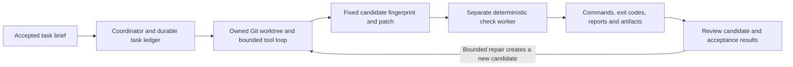

# Next increment: bounded software builder and tester

Delivery-order update: the [combined llama.cpp and hybrid harness plan](HYBRID-HARNESS-PLAN.md) now places the llama.cpp vertical slice and stage-aware KiCad tool loop first. The software candidate/evidence contract below remains applicable. A pinned OpenCode compatibility spike decides whether to reuse its coding execution behind the coordinator.

Implementation plan following JaxOS 0.3.0 and the [OpenCode desktop comparison](research/OPENCODE-DESKTOP-ADOPTION.md). This is planned work; the current chat still cannot edit files or execute tools.

Continue Electron, React and the TypeScript coordinator. Reuse SQLite history/tasks/events, command admission, model profiles and the KiCad evidence conventions. The first engine path is a bounded TypeScript tool loop over the existing Ollama adapter. A pinned OpenCode adapter remains optional; do not run two independent schedulers over one task.

## First complete workflow

1. Pick/register a software Git repository alongside existing KiCad projects. Resolve the native selection into an authorized project ID; inspect the Git executable, repository root, HEAD and worktree status.
2. Record an objective, constraints and named acceptance checks. Make the base revision explicit. Preserve the source checkout and its uncommitted files; the task worktree begins from the selected commit rather than silently inheriting dirty changes.
3. Admit a task with a command ID and create an owned branch/worktree. Persist the worktree identity before editing. A recovered task reconciles that identity and reports uncertainty instead of creating another worktree or rerunning writes automatically.
4. Expose bounded project listing/reading, patch application and named check operations. Resolve paths through the owned worktree, validate completed tool arguments and retain operation IDs/results. Begin by exercising the existing KiCad services and a small software fixture; expand the catalog only with concrete use cases.
5. Run the model loop with step/time/token/output budgets, queue/cancellation state and explicit terminal outcomes. Models without usable tool support remain conversational. Task-quality evaluation must accompany advertised capability metadata.
6. Save a candidate patch plus a fingerprint covering tracked/untracked candidate inputs and the declared check recipe. Hand a fixed candidate to a separate check worker; record environment, commands, working directory, start/end times, exit codes, logs and artifacts. Check execution may write temporary/build outputs, so a tester role label is not read-only isolation.
7. Show changes and each acceptance result. A passed build, failed test, skipped check and unrun check remain distinct. Further edits invalidate the prior candidate's results. A repair consumes the remaining budget and produces a new candidate before retesting.

## Proposed persisted records

| Record | Required content |
| --- | --- |
| Software task | Task/command/project IDs, brief, constraints, accepted checks, base commit, worktree ID, role/model/profile, budgets, status. |
| Tool operation | Operation ID, validated tool/schema version, task/candidate reference, admitted input digest, lifecycle, result/error and artifact references. |
| Candidate | Base commit, patch/changed-file manifest, relevant content hashes, check recipe digest and creation time. |
| Verification | Exact candidate fingerprint, worker/tool/environment identity, commands, outcome per check, exit codes, logs/artifacts and staleness. |
| Engine session | Optional external engine/version, session ID, task linkage, capability contract and reconciliation state. |

These are target records extending the current ledger, not existing database tables. Apply explicit database migrations and retain backup/recovery behavior when adding them.

## Boundaries and staged extras

The coordinator owns task state, accepted requirements and completion. Workers own scoped execution and return actual results. A Git worktree separates candidate files/branches but shares repository metadata and does not provide an OS sandbox. Record and test the selected execution boundary on Windows; a command allowlist or model permission profile alone cannot contain arbitrary project scripts.

The renderer uses typed application operations. Native dialogs remain in Electron; model/provider or optional engine credentials remain in the trusted service layer. Keep the existing IPC until a concrete stream/window requirement calls for changing it.

Interactive ConPTY/xterm sessions follow the first noninteractive workflow. Their attach/detach, working directory, input, resize, exit and cancellation behavior need separate Windows tests. A live terminal's output is not a deterministic acceptance report. Structured task forms, richer hunk review, editors/highlighters, MCP and extensions are follow-on surfaces; they do not block a first inspectable patch plus real check result.

For a future OpenCode adapter, pin one validated CLI/client contract, probe version/capabilities, retain the engine session ID and reconcile durable state after disconnect. An accepted prompt, successful RPC or finished model answer is not a passing verification result.

## Acceptance before packaging the next slice

- A real small repository change produces an inspectable patch and a passing declared check, with original checkout bytes unchanged. A deliberately broken candidate produces a recorded failure.
- Concurrent duplicate submission creates one task/worktree. Conflicting command reuse is rejected. Restart during admission/editing/check execution yields the same recorded task and no blind side-effect replay.
- Path traversal, symlink escapes, malformed/partial tool calls and unknown tools fail without modifying unauthorized files. Command/process cancellation terminates the intended job tree on Windows.
- Step/time/output budgets stop a looping or noisy task and preserve inspectable partial results. Provider failure/retry does not duplicate a tool operation.
- The verifier records the exact tested candidate. A subsequent edit makes its evidence stale; a repair creates a fresh candidate/result.
- Real Electron controls show queued/running/interrupted/failure/success truth, and existing local-model, migration/search/backup, tray and KiCad regressions continue to pass.

Native Windows process/worktree behavior and real-model tool quality require executed evidence. The existing 59 unit/integration and nine Electron passes describe 0.3.0 only; they do not validate this proposed tool loop.
