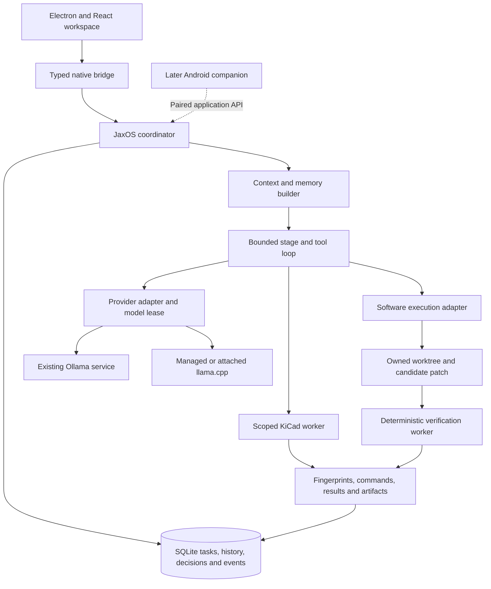

# JaxOS: llama.cpp and a Hermes/OpenCode-inspired harness

**Implementation status:** Desktop 0.4.0 implements the first llama.cpp/provider and bounded KiCad stage-tool increment. The research, optimizer, general coding, networking and Android proposals below remain planned. See [current architecture](ARCHITECTURE.md) and [validation](VALIDATION.md).

Planning baseline: 20 October 2026. This is the implementation direction requested by the user, not a claim that the proposed features are released. Retain Electron + React + TypeScript, the existing coordinator and SQLite store. Windows is the first host; Android is a later companion that depends on an awake, reachable Windows PC.

The uploaded Peiranava proposal is assessed separately in [PEIRANAVA-COMPARISON.md](PEIRANAVA-COMPARISON.md). It proposes research and optimizer additions and identifies corrections; those recommendations are not yet implemented or silently substituted for this baseline.

## Adopted direction

Combine Hermes's continuity, context and reusable-workflow patterns with OpenCode's repository execution and review patterns. Add llama.cpp as an inference runtime alongside Ollama. The JaxOS coordinator remains the owner of accepted requirements, task state, permissions and evidence.

| Component | Adopt | JaxOS responsibility |
| --- | --- | --- |
| Hermes inspiration | Persistent sessions, context checkpoints, sourced memory, reusable skills and a personal assistant workspace. | Implement these against the existing store; importing a second full agent daemon is unnecessary for the first slice. |
| OpenCode inspiration | Supervised execution, scoped repository tools, worktree candidates, structured questions, diffs and verification. | Start with the existing KiCad services. Evaluate a pinned OpenCode coding adapter before rebuilding its entire software tool stack. |
| llama.cpp | Local GGUF inference, startup context allocation and CPU/GPU placement. | Own managed process lifecycle, capability discovery, credentials, resource scheduling and normalized streams. |
| JaxOS | The desktop, project brief, workflow, durable ledger, policy and release evidence. | One canonical task/evidence owner across native tools and any external coding engine. |

No source inspection establishes that either upstream harness is universally best. The chosen patterns fit this product; their local-model reliability must be measured on representative tasks. Check licenses and redistribution obligations before copying source or bundling third-party binaries.

## Target architecture

React renders state and requests named operations. Electron owns windows, tray, dialogs and file selection. The coordinator validates scope and records admission before execution. Workers return actual outcomes. Keep the current private IPC; introduce MessagePort streaming only when terminal/log throughput warrants it. Do not introduce Python or Rust as a second application runtime without a specific dependency that requires it.

The native KiCad loop and an optional OpenCode loop must never independently edit the same candidate or schedule the same task. An engine's accepted prompt or final answer is not a JaxOS verification result. Engine session IDs, versions and interruptions are reconciled into the canonical ledger.

## Five visible stages

The four personal roles remain useful presets: Brainstormer, Daily driver, Builder and Tester. Stages describe progress through a project. A stage is a policy and artifact contract, not a requirement to spawn another agent or load another model. Start with sequential work and one inference lease.

| Stage | Work | Durable output and transition condition |
| --- | --- | --- |
| Analysis | Inspect authorized project material, identify the problem, constraints, assumptions and unknowns. | Sourced findings and a task brief with explicit acceptance checks. |
| Plan | Compare options, identify dependencies, risks and checks, and propose bounded steps. | A versioned plan tied to the accepted brief. Changes to requirements update that record. |
| Design | Define software/circuit structure and interfaces, then implement a candidate through permitted tools. Generate a visual mockup before substantial new UI work. | Design decisions plus a reviewable patch or saved design candidate. Implementation/build belongs inside this stage. |
| Test | Run declared checks on the fixed candidate, inspect failures and use bounded repair attempts. | Per-check passed/failed/error/cancelled/skipped/unrun outcomes, logs and the tested fingerprint. Repair returns to Design and invalidates previous results. |
| Launch | Run the candidate locally, prepare the requested package or generate a checked electronics handoff. | Artifact manifest, checksums, exact tested inputs and release notes. Installation/launch smoke results are recorded separately. |

Launch initially means local run and package/handoff preparation for the personal Windows release. External publishing, deployment, hardware ordering and flashing are separate actions with explicit targets; entering this stage does not authorize arbitrary external side effects. A failed check cannot become a pass because the model declares completion.

With no attached project, Analysis/Plan/Design remain conversational. Tool availability follows stage and project capability. For the first KiCad loop, Analysis and Plan inspect; Design may preview; Test may run ERC/DRC; Launch may request the existing fabrication workflow, which must still perform its deterministic checks. These permissions do not grant arbitrary filesystem or shell access.

## llama.cpp runtime contract

Support two clearly labelled connection modes:

1. **Managed GGUF:** the user selects an installed `llama-server.exe` and local GGUF. JaxOS validates them, probes the server version, launches a private loopback process, waits for model readiness and owns its stop/unload behavior. An owned supervisor releases the child when the coordinator exits. A supervisor is not an OS sandbox.
2. **Attach to server:** connect to an existing loopback llama.cpp endpoint. Discover its models, context and capabilities. JaxOS does not claim ownership or restart it to apply settings. API credentials stay on the trusted side and are session-only initially.

Keep three separate interfaces: inference, capability inspection and optional lifecycle management. OpenAI-compatible chat does not standardize loading or GPU controls. Do not assume router load/unload endpoints exist on every llama.cpp build.

| Control | Managed llama.cpp | Attached llama.cpp |
| --- | --- | --- |
| Model | Select a local GGUF; verify the running model alias and metadata. | Select a model reported by the server; verify local provenance where available. |
| Load/unload | Start/stop only the owned process; retain weights. Apply idle policy after preload and after generation. | Disabled unless a separately tested management API is explicitly supported. |
| Context length | Startup allocation; a change requires a controlled reload before the next task. | Display effective allocation; prevent requests that exceed it. Changing a client number cannot enlarge the server window. |
| GPU offload | Auto, CPU only or a validated layer count. Probe supported flags/backends; show requested versus observed placement when measurable. | Display only what is reported; configure placement outside JaxOS. |
| Thinking | Auto/Off/On or effort levels only where the model/template and selected build support them. Reasoning is separate from final text. | Same capability rule; no promise that every model exposes a reasoning switch. |
| Generation | Validated output limit and temperature; additional sampling controls only when tested. | Apply supported generation options without pretending they change server allocation. |
| Memory and performance | Report measured fields; VRAM remains unknown when the runtime does not expose it. | Same rule. Disk size is not resident-memory use. |
| Downloads | Select existing weights first; verified downloads are a later feature. | Owned by the attached runtime. Existing Ollama downloads remain available. |

Begin validation on a modest 4K context and CPU, then test larger windows and Windows GPU backends on actual hardware. A model's advertised maximum is not a memory-fit guarantee. Resolve conflicts between the existing profile CPU policy and llama-specific layer settings into one effective placement setting; never present two contradictory controls.

Persist a provider-specific profile identity including runtime endpoint/managed configuration and model identity. Keep legacy Ollama profile keys readable. Snapshot provider, model/digest, resolved profile, runtime version and effective context at admission so later Settings changes cannot alter a queued task's provenance. Changing endpoints clears session credentials. Owned-server keys must not enter transcripts, logs, exports, process arguments or release artifacts.

Default to one local generation at a time across conversation, planning, memory extraction and coding engines. Acquire/release a model lease around work; an idle timer must not unload a model in use. Model switching and context reloads are serialized. Cancellation stops generation independently from unload. Out-of-memory or unsupported controls produce actionable errors; there is no silent cloud fallback.

## Harness and evidence contract

The execution loop resolves task/stage/project/model/policy and budgets, assembles context, streams inference, validates completed calls, records tool intent, executes, records the result, and continues or stops. Never dispatch partial arguments. Unknown tools, invalid schemas and scope escapes fail before execution.

Use finite defaults, configurable per task: at most six tool operations before yielding, two repair attempts, a five-minute loop deadline, a separate bounded worker timeout, bounded tool-result excerpts and an aggregate generation-token budget. These are starting policy values to calibrate, not measurements. The effective context bounds every individual turn and includes tool schemas/results. A valid operation can still fail its acceptance check.

Target lifecycle: `queued → running → waiting_input | completed | failed | cancelled | interrupted | budget_exhausted`. Tool operations additionally track admitted/running/uncertain states. Persist task/operation IDs and input digests before side effects. Reconnect reconciles existing receipts and engine sessions rather than replaying writes. Do not retry a partially emitted answer into the same message without an explicit attempt record.

Extend the current ledger through explicit migrations with:

- **Task/plan:** objective, constraints, stage, accepted checks, model/profile, execution policy and remaining budgets.
- **Tool operation:** stable operation ID, schema version, input digest, scope, lifecycle, result/error and artifact references.
- **Candidate:** base commit, owned worktree, patch/changed-file manifest, content fingerprints and check-recipe digest.
- **Verification:** exact candidate, environment/tool versions, command/working directory, timestamps, exit codes, outcomes, logs/artifacts and staleness.
- **Engine session:** selected engine/version, session ID, task link and last reconciled cursor/status.
- **Release:** candidate and verification references, artifact names/hashes, packaging version and native smoke-test status.

Git worktrees separate candidate files and branches while sharing repository metadata; they do not contain malicious project scripts. Choose and validate the worker execution boundary on Windows. Preserve the user's original checkout, including dirty files. Test execution itself may modify files, so use a disposable verification candidate and detect source changes. Keep an interactive ConPTY terminal separate from deterministic build/test jobs.

## Context, memory and skills

Enforce `input + reserved output + safety margin <= effective context`. Count instructions, tool schemas, retrieved files, complete message/tool groups and result excerpts. Prefer tested runtime tokenization when available; otherwise label a conservative estimate and compare it with reported usage. Reasoning consumes the provider's output allocation according to its actual semantics.

Keep full history in SQLite. Add resumable checkpoints containing the objective, constraints, decisions, completed steps, source/artifact links, blockers and next step. Summaries never replace canonical acceptance criteria or original evidence. Store stable memory with source, scope and correction/version history; retrieve relevant project context instead of resending every conversation.

Extract reusable skills from observed workflows as candidates. Retain prerequisites, bounded steps, failure cases, validation evidence and versions. Activate them after relevant checks; retain revision/deactivation history. Skills do not gain extra execution permission. This is reusable application knowledge, not model training. Memory/skill generation yields to interactive inference.

## Delivery sequence and release gates

| Increment | Deliverable | Gate before calling it complete |
| --- | --- | --- |
| 1 — llama.cpp vertical slice | Provider-aware settings, native pickers, managed/attached connections, profiles, streaming/reasoning, ownership and resource queue. | Real GGUF chat; requested/effective context; thinking modes and output limits; malformed/truncated SSE; cancellation; idle unload; coordinator-death cleanup; legacy Ollama regression; no leaked credentials; actual packaged process path. |
| 2 — five-stage KiCad harness | Stage selector, bounded named tools, durable tool receipts and visible evidence using existing services. | Real passing and failing ERC/DRC; checked fabrication handoff; wrong-stage/unknown/malformed calls rejected; duplicates reconciled; restart/cancel/budget paths; stale inputs never pass. |
| 3 — software builder/tester | Repository registration, owned worktree, candidate diff, declared checks and bounded repair. | A real small code change passes its check; a broken change fails; original checkout preserved; candidate changes invalidate evidence; Windows job-tree cancellation verified. |
| 4 — continuity | Checkpoints, sourced memory, role presets and reusable skills. | Long-session resume retains accepted requirements and tool pairs; retrieved facts have provenance; stale/incorrect memory and skills can be corrected. |
| 5 — Android companion | Authenticated application API, pairing/revocation, event reconciliation, phone drafts and task monitoring. | Real device reconnect without duplicate jobs, revoked access rejected, project scope enforced and truthful PC-off behavior. |

Before implementing increment 3, run a pinned OpenCode compatibility spike against the selected llama.cpp/Ollama profiles: configuration of the local endpoint, completed tool calls, scoped repository access, session recovery, cancellation and candidate/evidence extraction. Start from the inspected 2.1.0 contract, but validate the actual binary/version selected. If it passes, use it behind one coding-engine adapter. If it fails, document the missing contract and implement a bounded native tool slice; do not silently run two schedulers or mix incompatible API examples.

Each increment is a complete vertical workflow. Package only after relevant unit/integration and real Electron checks, artifact verification and a documented Windows smoke result or explicit pending status. The earlier three-hour personal-installer goal does not establish that this entire roadmap can be production-validated within that window. No release date is promised without measuring the first slice.

## Current implementation boundary

Desktop 0.4.0 connects the provider contracts, SSE parsing, managed supervisor, attached-server mode, persisted settings/profiles and Settings UI. The stage selector and bounded named KiCad tools now run through `AppService`, with durable tool receipts and actual run evidence. This implements the first provider/KiCad increment; it is not a general software or research agent.

The final suite passed 77 unit/integration tests and 11 actual Electron scenarios without skips. Live managed checks used the Ollama-bundled llama-server `0.5.0-dev`, build 1, commit `631109b34`, with a local Qwen GGUF, CPU-only 4K/8K contexts, thinking, cancellation, crash/idle cleanup and archive loading. A real model-selected DRC preserved three findings and failure after restart. Existing deterministic check/fabrication services retain their passing/failing integration coverage. Every stage/tool combination has not been exercised by a real model; policy/argument restrictions have controlled tests. Attached-server GUI, standalone Windows/GPU compatibility and native Windows installation remain acceptance work. See [validation](VALIDATION.md).

The delivery table above remains the broader acceptance roadmap: checked fabrication has existing deterministic integration coverage, while wider real-model stage selection, window-specific process cleanup and the remaining software/research/mobile increments require their own evidence. No OpenCode coding engine is embedded yet.

Implementation touchpoints: `shared/types.ts` and `shared/provider-settings.ts`; `electron/llama-http.ts`, `providers.ts` and `llama-host.ts`; `electron/harness.ts` for stage policy and budgets; `electron/service.ts` for durable admission/scheduling; `electron/context.ts`; repository/SQLite persistence; typed preload/native file selection; Settings/Chat controls and receipts. Unknown VRAM is explicitly unknown, and requested layer count is not measured acceleration. The 0.3.0 artifact and versioned receipts remain preserved as historical release evidence.

Schematic generation, simulation, wiring assistance, live KiCad editing, PCB generation and instrument/physical testing remain separate electronics milestones in [ELECTRONICS-PLAN.md](../ELECTRONICS-PLAN.md). A saved-file ERC/DRC or package check does not establish physical electrical safety or manufacturing readiness. Blueprint feature parity remains unverified; see the [access findings](research/BLUEPRINT-ACCESS.md).

## Evidence and related plans

- [Current implemented architecture](ARCHITECTURE.md), [storage](STORAGE.md), [validation](VALIDATION.md) and [Windows acceptance](WINDOWS-RELEASE.md).
- [Hermes adoption decisions](ADOPTION-DECISIONS.md), based on source pinned at `97a9ae8ee55d31bebce49f1fb6b5ef775323976a`; particularly [agent loop](https://github.com/NousResearch/hermes-agent/blob/97a9ae8ee55d31bebce49f1fb6b5ef775323976a/website/docs/developer-guide/agent-loop.md), [context compression](https://github.com/NousResearch/hermes-agent/blob/97a9ae8ee55d31bebce49f1fb6b5ef775323976a/website/docs/developer-guide/context-compression-and-caching.md) and [session storage](https://github.com/NousResearch/hermes-agent/blob/97a9ae8ee55d31bebce49f1fb6b5ef775323976a/website/docs/developer-guide/session-storage.md).
- [OpenCode Desktop 2.1.0 adoption research](research/OPENCODE-DESKTOP-ADOPTION.md), source revision `60c68d145a14127ce633e26aa5fdfb882a7baa6d`, with fetch/digest records. Older 2.0.26 research describes a different snapshot.
- [llama.cpp server documentation](https://github.com/ggml-org/llama.cpp/blob/f2cc7282ce0042641df55e0e563b75e824e2b647/tools/server/README.md), a pinned inspected snapshot; endpoint/flag compatibility must be tested against the selected build.
- [Detailed software candidate and verification plan](BUILDER-TESTER-PLAN.md), [local-model research](LOCAL-MODEL-HARNESS.md) and [Android plan](../MOBILE-PLAN.md). This document sets the new delivery order; existing evidence requirements continue to apply.
