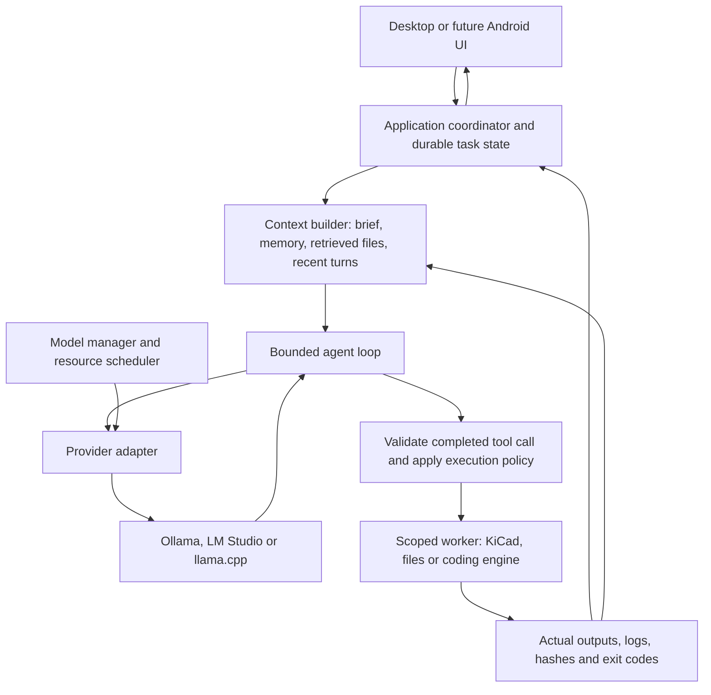

# Local models and the JaxOS agent harness

**Current implementation, 0.4.0:** Ollama and llama.cpp now share normalized generation/tool contracts, with managed GGUF lifecycle and attached-server mode. A bounded stage-aware KiCad tool loop records intent before execution and results afterward. SQLite WAL/FTS5 history, tasks/events and idempotent admissions remain. Context checkpoints, reusable skills and general software editing/build/deploy remain planned. See [current architecture](ARCHITECTURE.md), [runtime guide](LLAMA-AND-WORKFLOW.md) and [validation](VALIDATION.md); these supersede the historical audit below.

**0.2.0 implementation update, 20 October 2026:** model metadata/residency, explicit load/unload/download, saved context/output/thinking/temperature/keep-alive/CPU-policy profiles, separate reasoning/usage, conservative context budgeting, queued generation and coordinator isolation are now implemented. The general agent tool loop, automatic summary/retrieval and additional providers remain future work. [Current architecture](ARCHITECTURE.md) and [validation](VALIDATION.md) supersede the historical 0.1.0 audit below. Source line references below describe that earlier code.

Analysis date: 12 October 2026. This is an implementation audit and an upgrade design. The 0.1.0 installer has the capabilities in the first table; the proposed controls and agent loop below have not been added to that installer.

Supplement, 20 October 2026: the user's Hermes desktop IPC report was compared with official desktop source. The [desktop/service boundary analysis](research/HERMES-DESKTOP-IPC.md) corroborates the native Electron bridge and shared headless gateway, distinguishes distribution variants and static call counts, and maps those findings to the proposed JaxOS model-manager/service contracts. The installer is unchanged.

JaxOS already connects to installed local models through Ollama. The next release should add a model manager and a durable agent harness around that connection. Model lifecycle, inference settings, context management, and tool execution are separate responsibilities with separate state.

## Historical 0.1.0 implementation audit

| Capability | JaxOS 0.1.0 behavior | Required extension |
| --- | --- | --- |
| Local model connection | Loopback Ollama URL, installed-model discovery through `/api/tags`, model selection, streamed `/api/chat` responses. | Provider adapters and richer capability discovery. |
| Loading | Ollama loads the selected model when a chat request needs it. | Explicit preload, loading/ready state, loaded-model inspection. |
| Unloading | JaxOS sends no lifecycle request or `keep_alive` setting; Ollama manages residency. | Explicit unload and an idle timeout/keep-loaded policy. Unload must preserve downloaded weights. |
| Downloads | Install or pull models outside JaxOS, then refresh the list. | Streaming download progress, cancellation/reconciliation, disk-space checks. |
| CPU/GPU placement | Managed by the existing Ollama service. JaxOS exposes no hardware controls or residency information. | Show reported RAM/VRAM and processor placement; automatic placement first, provider-specific expert settings later. |
| Context size | `options.num_ctx` is hardcoded to **8,192**. | Validated, persistent settings per model/profile, with requested versus effective runtime context. |
| Thinking | `think:false`; parser consumes only `message.content`. | Capability-dependent thinking controls and a separate reasoning stream. |
| Generation controls | No UI for output-token limits, temperature, top-p, seed, or repeat penalty. | Validated per-model defaults and an advanced settings area. |
| Context selection | Latest complete messages, at most 30 and roughly 28,000 characters; up to 8,000 characters of project notes. | Token-aware budgeting, summary checkpoints, retrieval, preserved message/tool groups. |
| Telemetry | Final `done` is checked; usage, timing, reasoning, tool calls and finish reason are discarded. | Normalized usage, finish reasons, loading/prefill/generation timing, and token rates. |
| Agent execution | Chat explicitly has no tools. KiCad jobs are started through separate UI controls and preserve real evidence. | A bounded tool loop that invokes those existing typed services. |
| Role selection | Four mode prompts share one global selected model. | Optional model/settings/tool-policy profiles for each role. |
| Concurrency | One response per conversation, at most two active chats; no hardware-aware model queue. | A scheduler with one local generation by default, bounded queuing and model leases. |

Audit locations: [Ollama adapter](../electron/ollama.ts), [context and mode assembly](../electron/service.ts), [settings UI](../src/components/Settings.tsx), and [shared API](../shared/types.ts). In particular, `electron/ollama.ts:82` fixes thinking and context; `electron/service.ts:154` disables chat tools; the following history-selection loop counts characters rather than tokens.

Read-only checks against the cloud's actual Ollama server returned version **0.40.3** and an installed `qwen3:0.6b` model. `/api/show` advertises `completion`, `tools`, and `thinking`, with `qwen3.context_length:40960`. `/api/ps` was empty at inspection time: installed does not mean currently resident. These are observed metadata and state, not a new reasoning, GPU, or maximum-context benchmark. The earlier MVP validation exercised real non-thinking inference and persistence.

## What loading and offloading mean

**Download/install** puts weights on disk. **Load/preload** creates an inference instance in RAM/VRAM. **Unload** frees that resident instance while keeping the download. **GPU offload** places supported computation/model layers on the GPU rather than the CPU. Unloading a model and changing GPU placement are different actions.

Ollama documents empty `/api/generate` or `/api/chat` requests for preloading, `keep_alive` for residency, and an empty generation request with `keep_alive:0` for unloading. Its documented ordinary residency default is five minutes, but server configuration and scheduling can change it. JaxOS should report the observed `/api/ps` state and expiry instead of assuming a timer proves the model is resident. A stopped chat does not prove its model was unloaded.

Runner parameters such as `num_ctx` and `num_gpu` affect a loaded runner and can cause reconfiguration/reloading. Sampling parameters affect generation. Server-wide settings such as parallelism, model limits and KV-cache configuration belong to the runtime configuration; attaching to an existing service should not silently change its environment or restart it.

Memory planning must include weights, KV cache, runtime buffers and concurrency. Download size is not the total resident memory requirement. Longer contexts consume more KV memory; multiple active contexts can increase it further. Prefer measured profile settings on the user's Windows hardware over promising that a model's advertised maximum will fit or perform well.

A localhost address alone does not establish local inference for every installed tag: current Ollama types include remote-model/remote-host metadata. A local-only profile must identify local weights and reject or clearly label cloud-backed routes. The inspected Qwen model is a local GGUF model.

## Provider design

| Runtime | Verified control surface | Recommended use |
| --- | --- | --- |
| Ollama | Native APIs for installed models, model details, running models, pulls, chat/generation, keep-alive, tools, thinking, usage; runner and sampling options. | First fully supported provider. Reuse the current adapter and add lifecycle/capability methods. |
| LM Studio | Official TypeScript SDK explicitly supports load/unload, load configuration including context/GPU offload, model information, local generation and tools. Its generic model namespace implements lifecycle methods. | Second Windows provider. Use the native SDK for management, rather than assuming chat compatibility supplies those controls. |
| llama.cpp server | Explicit context/GPU-layer/parallel/cache/reasoning flags; the inspected router supports `/models/load` and `/models/unload`. | Expert GGUF profile with a pinned server build and separate management of launch-time settings. Router endpoints depend on router configuration/version. |

OpenAI-compatible chat is useful for exchanging messages. It does not define a universal model-loading API, context allocation policy, GPU configuration, or reasoning field. Keep an inference interface and an optional lifecycle interface; disable unsupported controls for a connected provider.

Suggested adapter operations are `listInstalled`, `inspectCapabilities`, `listLoaded`, `download`, `load`, `unload`, and `generate`. A capability record should state whether each operation and option is supported, with the detected runtime version and the source of the capability. Record model identity/digest and the resolved profile on each run so later setting changes cannot alter its provenance.

## How modern harnesses are built

A harness assembles a request, interprets the model's output, runs permitted tools, persists results, and decides whether to continue. The inference runtime owns model execution and resources; the application owns the task and completion criteria. Some runtimes/SDKs also provide tool-loop helpers, but that does not replace application state, permissions, or verification.

The core loop is:

1. Resolve the role, model capability profile, project revision, tool policy and budgets.
2. Acquire the model resource lease and assemble context within the effective window.
3. Stream normalized text, reasoning, tool-call, usage and finish events.
4. On a completed tool call, validate its schema and resolve project/artifact IDs through the service. Execute only after the applicable policy permits it.
5. Save the actual result and append a bounded representation with an artifact reference to the conversation. Large logs stay in artifacts.
6. Continue until a final response, cancellation, error, waiting state or step/time/token budget limit.
7. Mark task acceptance from the recorded tests and the delivered revision; a final model message alone cannot establish a successful build.

Never execute partial streamed tool arguments. Tool-call/result pairs and complete exchanges must remain together during context pruning. An accepted or queued job needs a terminal result before the harness can describe its outcome. Cancellation should be acknowledged by the worker and reconciled after reconnects. A retry of inference and a retry of a tool that changed files have different semantics; write operations need action IDs and recovery/reconciliation rather than blind replay.

MCP can supply tool discovery and transport. The application still needs schema validation, permissions, execution boundaries, cancellation and evidence. A tool permission rule is also distinct from an operating-system sandbox.

## Findings from Hermes and OpenCode

**Hermes** supplies the clearest continuity pattern. The inspected pinned architecture has a provider abstraction, prompt assembly, an interruptible conversation loop, tool dispatch, reasoning callbacks, compression, SQLite sessions, memory providers and session lineage. Its documented compressor preserves recent messages and tool pairs, summarizes older material, and creates a lineage checkpoint. Prompt construction separates stable, context and volatile content. This supports a personal daily assistant that retains decisions without resending every old message.

**OpenCode** supplies the coding workflow pattern. The inspected `dev` snapshot declares version 2.0.26 and separates model resolution, compaction, bounded retry logic, durable session inputs and tool-capable agent configuration. Its compaction implementation preserves recent context alongside a summary and handles context-overflow recovery. The global SSE event contract is explicitly volatile; the experimental session log provides sequence-based durable replay. A mobile client therefore needs persisted task state and reconciliation, rather than assuming all progress events were received.

Use these patterns selectively. Their context thresholds and defaults are designed for their supported models; copying large-context fallback windows or reservation constants into an 8K local profile would be incorrect. Pin an actual engine/API version before integrating OpenCode: previous web examples and this v2 contract differ.

JaxOS can retain one task/evidence owner and use an OpenCode adapter for repository work. Hermes can remain an inspiration or an optional engine adapter. Requiring two independent engines to schedule and declare completion for the same job would make ownership ambiguous.

## Context and thinking controls

The context budget should satisfy:

`assembled input + reserved generation + safety margin <= effective context window`

Input includes instructions, tool schemas, retrieved material, conversation and tool results. The generation reservation must follow the provider's treatment of reasoning and final-answer tokens; do not count the same shared output budget twice. Use exact tokenization where the provider exposes it, otherwise a conservative per-model estimator calibrated against reported usage. Show estimated versus measured usage honestly.

Full history belongs in durable storage. A compact checkpoint should retain the current objective, accepted constraints, decisions, completed work, source/artifact references, blockers and next step. Preserve recent complete exchanges; retrieve older details when needed. Canonical project facts and acceptance criteria should survive summary errors as structured records. KV/prompt caching improves repeated inference latency; it is not persistent application memory.

Expose thinking as a model capability: Auto/Off/On for supported boolean models, and named effort levels only where the provider/model honors them. Normalize reasoning separately from final text. A collapsible reasoning display is optional; it is model-generated text and does not prove that an action or test happened. Capture finish reasons such as token limit, tool request, stop and error instead of interpreting every `done:true` as an unqualified final answer.

Useful telemetry includes requested/effective context, input/output usage, reported load duration, prefill time, time to first reasoning/text, generation rate, queue time and resident-memory state. Track model/parameters at request start rather than reading mutable global settings afterward.

## Recommended JaxOS upgrade order

1. **Model manager:** installed versus loaded state, metadata/capabilities, explicit download/load/unload, residency policy and a conservative local generation queue. Support Ollama first.
2. **Inference profiles:** per-model context, maximum output, sampling and supported thinking controls, separate reasoning stream, finish reasons and telemetry. Add fast Daily and capable Build/Test profiles without requiring different models.
3. **Context engine:** budget enforcement, persisted checkpoints and project/file retrieval. Replace the current character-count truncation.
4. **Bounded tool harness:** expose existing KiCad check/preview/export services first, then scoped file operations and an OpenCode coding adapter. Every operation keeps exact source revision and actual results. Independent verification uses a fixed candidate and a deterministic test worker.
5. **Background coordinator and Android:** move orchestration behind a standalone authenticated service, with durable events, cancellation/reconnect recovery and revocable pairing. Preserve the existing narrow Electron bridge for native desktop operations.

The current separately testable `AppService` and KiCad evidence adapter are useful foundations. Database/event-log migration becomes justified when background work and multiple clients need durable coordination; the existing atomic workspace data needs an explicit migration/recovery path.

Acceptance for these upgrades should exercise real preload/unload state, setting round-trips, effective context, reasoning/final text separation, token-limit finishes, overflow recovery, unknown or malformed tool calls, cancellation, repeated writes after interruption, source staleness and restarted/reconnected tasks. GPU placement and native Windows behavior require the actual Windows hardware. Metadata declaring a capability is only the starting point; small models also need task-quality evaluation.

## Primary evidence

Fresh source inspection used pinned revisions. Hermes uses the previously inspected release/source snapshot; the other references below were resolved from their upstream branches during this analysis. Upstream applications were not installed or executed in this research. Ollama metadata endpoints were queried read-only. Documentation websites/API hosts were proxy-blocked, while official raw GitHub source and Git refs were accessible.

- [Ollama API](https://github.com/ollama/ollama/blob/eab97e9f92b9a25c2d52d2cc6c1b1c99bd9fae21/docs/api.md), [runtime FAQ](https://github.com/ollama/ollama/blob/eab97e9f92b9a25c2d52d2cc6c1b1c99bd9fae21/docs/faq.mdx), [types](https://github.com/ollama/ollama/blob/eab97e9f92b9a25c2d52d2cc6c1b1c99bd9fae21/api/types.go), and [scheduler](https://github.com/ollama/ollama/blob/eab97e9f92b9a25c2d52d2cc6c1b1c99bd9fae21/server/sched.go).
- [Hermes architecture](https://github.com/NousResearch/hermes-agent/blob/97a9ae8ee55d31bebce49f1fb6b5ef775323976a/website/docs/developer-guide/architecture.md), [agent loop](https://github.com/NousResearch/hermes-agent/blob/97a9ae8ee55d31bebce49f1fb6b5ef775323976a/website/docs/developer-guide/agent-loop.md), [compression/caching](https://github.com/NousResearch/hermes-agent/blob/97a9ae8ee55d31bebce49f1fb6b5ef775323976a/website/docs/developer-guide/context-compression-and-caching.md), and [session storage](https://github.com/NousResearch/hermes-agent/blob/97a9ae8ee55d31bebce49f1fb6b5ef775323976a/website/docs/developer-guide/session-storage.md).
- [OpenCode compaction](https://github.com/anomalyco/opencode/blob/35ef229454d3664624ca798f53341858fc0dc33d/packages/core/src/session/compaction.ts), [model resolution](https://github.com/anomalyco/opencode/blob/35ef229454d3664624ca798f53341858fc0dc33d/packages/core/src/session/runner/model.ts), [retry policy](https://github.com/anomalyco/opencode/blob/35ef229454d3664624ca798f53341858fc0dc33d/packages/core/src/session/runner/retry.ts), [session contract](https://github.com/anomalyco/opencode/blob/35ef229454d3664624ca798f53341858fc0dc33d/packages/protocol/src/groups/session.ts), and [event contract](https://github.com/anomalyco/opencode/blob/35ef229454d3664624ca798f53341858fc0dc33d/packages/protocol/src/groups/event.ts).
- [LM Studio SDK](https://github.com/lmstudio-ai/lmstudio.js/blob/b8b17aa18d02288a5040b0b8aaffa27eb6c314db/README.md) and [model lifecycle](https://github.com/lmstudio-ai/lmstudio.js/blob/b8b17aa18d02288a5040b0b8aaffa27eb6c314db/packages/lms-client/src/modelShared/ModelNamespace.ts).
- [llama.cpp server](https://github.com/ggml-org/llama.cpp/blob/f2cc7282ce0042641df55e0e563b75e824e2b647/tools/server/README.md).

Research downloads, status records and local metadata are saved under `/workspace/.analysis/modern-harness/`. The existing 0.1.0 release artifact is unchanged by this analysis.
