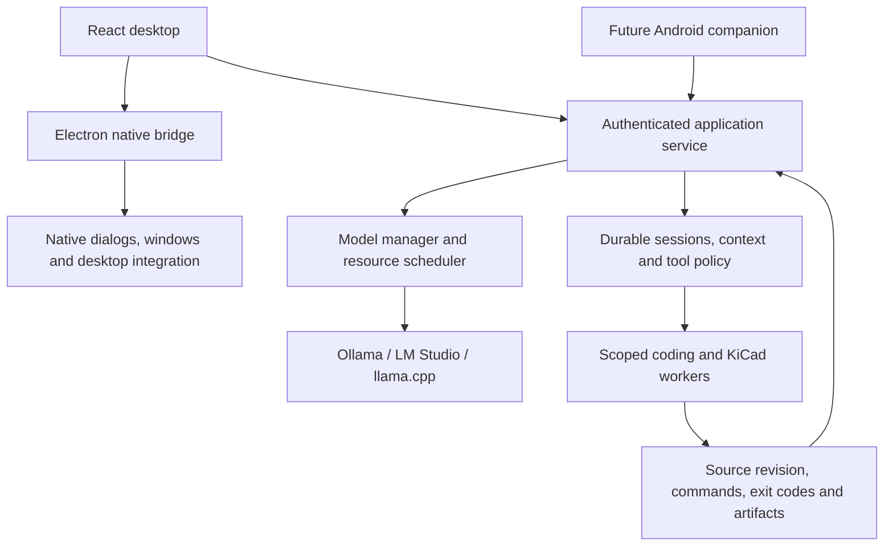

# Hermes desktop IPC and the JaxOS service boundary

**Implementation update:** 0.3.0 adds SQLite/task/history storage; see [storage](../STORAGE.md). the historical JaxOS baseline and proposed stages below describe 0.1.0. Version 0.2.0 now has the separate private-IPC coordinator, model lifecycle/profiles and optional tray mode. [Current architecture](../ARCHITECTURE.md) is authoritative for implemented behavior. Authenticated gateway/mobile access and a general agent tool loop remain planned; original Hermes corroboration and supplied binary limitations are unchanged.

Reviewed 20 October 2026 against the user's local REA report and the official Hermes source snapshot `97a9ae8ee55d31bebce49f1fb6b5ef775323976a`. The local installer and its exact build were not available in this cloud workspace. The report's binary findings and aggregate counts remain user-supplied evidence; selected desktop channels and architecture were independently corroborated from source.

The architectural lesson is to separate native desktop capabilities, the durable agent coordinator, and inference-runtime management. Our Electron + React choice fits that structure. The next important work is the service and model-control layer.

## What the source corroborates

The desktop README explicitly defines three boundaries: Electron resolves the backend and owns native filesystem/Git/window operations; React owns the application surfaces; Hermes Agent runs headless through `hermes serve` and exposes the `tui_gateway` JSON-RPC/WebSocket API. Desktop and the browser dashboard share the client code in `apps/shared`.

Sampled source confirms the report's `hermes:backend:touch`, `hermes:backend:recycle`, `hermes:gateway:ws-url`, `hermes:gateway:ws-url-for`, `hermes:agents:roster`, filesystem, Git and terminal operations. The scoped gateway handler uses connection/profile resolution and a fresh-ticket path for OAuth sources. The terminal module also constructs `hermes:terminal:${id}:${suffix}` dynamically.

This supports two communication planes:

- Desktop IPC for native integration, backend discovery and lifecycle, and connection setup.
- Gateway messages for agent conversations and shared application operations.

A mobile client uses the shared application service with authentication. It cannot directly reuse Electron's in-process IPC, filesystem handlers or window controls.

## How to interpret the installer and counts

The user reports a Tauri/Rust/WebView2 bootstrapper that provisions an Electron application under `%LOCALAPPDATA%\hermes\hermes-agent\apps\desktop\release\win-unpacked\resources\app.asar`. This is consistent with a bootstrap/source-install path and an Electron payload. The exact bootstrap framework still needs its binary/build evidence to be independently confirmed. Electron payload evidence does not identify every outer installer implementation.

The pinned official build guide also describes bundled Windows MSIX/Store packages and separate bootstrap/source paths. Installation and update ownership are distribution-specific. We should not apply the reported `.exe` implementation to every Hermes package or add a Tauri wrapper to JaxOS merely to match it.

The reported 516 IPC operations and 260 unique literal channel names describe a static interface surface. They are not a count of independently working product features. Invoke sites, handler definitions, listeners and push sites can describe different ends of the same operation; dynamic channels need separate accounting. The reported 169 handlers, 38 listeners and 44 push channels cannot be reconciled against a unique-name total without the scanner's exact counting rules and build.

For an actionable catalog, record channel name/pattern, source location, caller, receiver, request/response schema, push-event shape, ownership, authentication/project scope and lifecycle behavior. Trace representative operations through their backend to establish actual effects. A returned IPC promise can acknowledge an accepted job or terminal input without establishing that the underlying work completed.

## Mapping the subsystems to JaxOS

| Hermes subsystem in the report | JaxOS responsibility | Delivery priority |
| --- | --- | --- |
| Filesystem and native pickers | Desktop chooses project roots; service resolves project/artifact IDs and performs scoped operations. Current MVP already imports projects and reads verified artifacts. | Retain the bridge; extend operations as required. |
| Git status, diffs, worktrees and review | Builder workspace and change inspection, with candidate revision recorded for testing. | After model/context controls, as part of the software builder. |
| PTY terminal | Interactive user terminal and live output. Deterministic job execution keeps separate command IDs, exit codes and artifacts. | Builder milestone. |
| Backend probe, touch, recycle and gateway discovery | Coordinator lifecycle, health, reconnect and target/profile selection. | Core architecture before background/mobile work. |
| Agent roster | Available role/model/tool profiles with explicit capabilities. | Introduce with the bounded agent harness. |
| Cloud login and MCP OAuth | Optional provider/tool integration; credential handling on the trusted service/native side. | When a selected integration needs it. |
| Tray and keep-awake | Explicit background-operation and power policies, separate from model residency. | Daily-driver/background milestone. |
| HUD, pet and translucent overlays | Optional presentation surfaces sharing the same underlying state. | Later polish. |
| Bootstrap, repair and updates | Dependency diagnostics and verified release replacement appropriate to our distribution. | Improve diagnostics first; automatic updates need a separate release design. |

The audited 0.1.0 JaxOS bridge had 24 literal request registrations with matching preload wrappers and a state-push channel. This was checked directly in `electron/main.ts` and `electron/preload.ts` using literal wrapper-call enumeration, not a complete AST or dynamic-channel analysis. Its scope is smaller than the user's Hermes scan, so the numbers are not comparable quality scores.

At the audited 0.1.0 baseline, JaxOS constructed `AppService` inside Electron main. Quitting aborts and flushes its jobs. It has no independently running gateway/background daemon, no general agent tool loop, and no Android pairing. These are proposed extensions, not capabilities established by the Hermes comparison.

## Where model management belongs

The supplied desktop catalog does not trace model loading, unloading, GPU placement, context allocation or reasoning configuration. Those features need a separate path through the agent/provider backend into the inference server. The earlier [local-model analysis](../LOCAL-MODEL-HARNESS.md) documents the current JaxOS limitations and supported runtime APIs.

Proposed transport-independent application operations:

| Operation | Owner and result |
| --- | --- |
| `models.listInstalled` / `models.inspect` | Provider adapter returns identity, local/remote provenance and supported capabilities. |
| `models.listLoaded` | Runtime observer returns reported residency, effective context and memory information. |
| `models.download` | Model manager returns an operation ID; progress and terminal state are observable. |
| `models.load` / `models.unload` | Resource scheduler validates a model/profile request and tracks its actual runtime outcome. Active JaxOS work holds leases; shared-service ownership remains explicit. |
| `modelProfiles.get` / `modelProfiles.save` | Validated context/output limits, supported thinking settings, sampling, residency and optional hardware policy. |
| `sessions.run` / `sessions.cancel` | Agent coordinator owns the resolved profile, context checkpoint, step/time/token budget and final outcome. |
| `runs.get` / `events.subscribe` | Durable task state and sequence-based replay/reconciliation; live progress alone is insufficient after reconnect. |

These are proposed contracts, not new IPC handlers. The Electron preload should expose only the typed native/application operations its renderer needs. Backend heartbeat, OS sleep prevention, model keep-alive, generation cancellation and model unloading have independent lifecycles.

Recommended ownership:

Long-running jobs must outlive a renderer only when the background policy explicitly supports that lifecycle. A tray icon alone does not establish restart recovery. Model output, interactive terminal output and deterministic check evidence retain distinct provenance.

## Concrete next stages

1. Extend the current Ollama adapter with model metadata/residency and explicit lifecycle operations; add validated context, output and thinking profiles with truthful progress/finish states.
2. Extract coordinator ownership from the Electron window lifecycle, with durable jobs and reconnect reconciliation. Preserve a narrow native bridge and a migration path for existing local workspace data.
3. Add a bounded tool loop using the existing KiCad evidence services, then the scoped Git/worktree/coding-worker capabilities needed by Build/Test.
4. Introduce authenticated Android pairing against that shared service. Add optional desktop overlays and additional integrations after the core workflow is reliable.

This document refines the implementation plan. It does not change the existing installer or add the proposed capabilities.

## Corroborating sources

- [Desktop boundaries and distribution paths](https://github.com/NousResearch/hermes-agent/blob/97a9ae8ee55d31bebce49f1fb6b5ef775323976a/apps/desktop/README.md).
- [Windows packaging and update ownership](https://github.com/NousResearch/hermes-agent/blob/97a9ae8ee55d31bebce49f1fb6b5ef775323976a/apps/desktop/BUILDING.md).
- [Main-process backend/gateway handlers](https://github.com/NousResearch/hermes-agent/blob/97a9ae8ee55d31bebce49f1fb6b5ef775323976a/apps/desktop/electron/main.ts) and [preload bridge](https://github.com/NousResearch/hermes-agent/blob/97a9ae8ee55d31bebce49f1fb6b5ef775323976a/apps/desktop/electron/preload.ts).
- [Filesystem](https://github.com/NousResearch/hermes-agent/blob/97a9ae8ee55d31bebce49f1fb6b5ef775323976a/apps/desktop/electron/fs-ipc.ts), [Git](https://github.com/NousResearch/hermes-agent/blob/97a9ae8ee55d31bebce49f1fb6b5ef775323976a/apps/desktop/electron/git-ipc.ts), and [terminal](https://github.com/NousResearch/hermes-agent/blob/97a9ae8ee55d31bebce49f1fb6b5ef775323976a/apps/desktop/electron/terminal-ipc.ts) modules.

Fetched-source hashes and URLs are recorded in `/workspace/.analysis/hermes-desktop-ipc/sources.json`. This source snapshot is corroborating evidence and is not asserted to match the user's local installer version.
