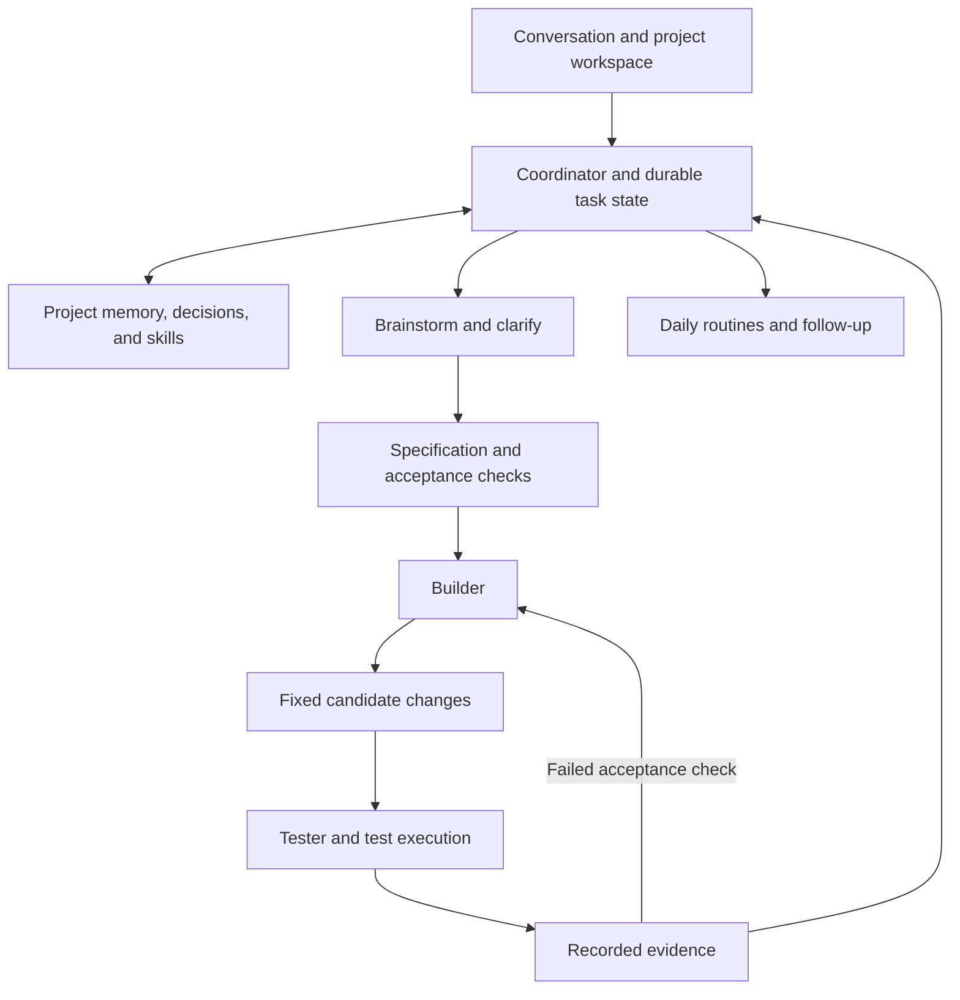

# A personal assistant for brainstorming, daily work, building, and testing

Research captured before the separate JaxOS Desktop MVP was implemented on 2026-10-11. Findings about the original JaxOS repository remain separate from the new desktop application; see ../../README.md for current delivered scope.

This assessment treats Nous Research's Hermes Agent and OpenCode as separate open-source inspirations. It reviews their upstream documentation and selected implementation files, together with the JaxOS checkout already available in this cloud task. It does not claim to inspect Blueprint: `E:\blueprint-backend` is on the user's computer and is not mounted here. The app lists a local `Daily_drive` project at `E:\`; a task running there can perform the missing code audit. Neither upstream application was installed or exercised for this analysis, and their moving branches may differ from locally installed releases.

The recommended product is one assistant with four modes, a shared project memory, and a durable record of work. The modes change the assistant's responsibilities and permitted actions while preserving the user's project context. Whether Blueprint already implements that foundation remains to be established from its code.

| Mode | User outcome | Useful inspiration | Concrete completion artifact |
|---|---|---|---|
| Brainstormer | Explore alternatives, challenge assumptions, and choose an experiment | Hermes's contextual conversation, reusable skills, and delegated research; OpenCode's planning/exploration distinction | Options with tradeoffs, assumptions, recommendation, and an actionable brief |
| Daily driver | Remember projects and preferences, retrieve prior decisions, track work, and run recurring routines | Hermes's persistent memory, searchable sessions, skills, scheduling, and messaging gateway | Updated project context, task list, decision log, and routine results |
| Builder | Turn a scoped requirement into working changes in a selected repository | OpenCode's repository tools, planning/building roles, sessions, command execution, and visible diffs | Candidate code changes, implementation explanation, execution log, and remaining blockers |
| Tester | Establish whether that candidate satisfies the requirement and detect regressions | OpenCode's custom agent roles plus an application-owned test runner and evidence store | Tested revision, commands, exit codes, reports, acceptance outcomes, and explicit gaps |

Hermes's useful lesson is continuity. Its focused documentation describes small persistent memory files, user information, searchable conversation history, and skills loaded on demand. Its scheduler supports recurring work, and its gateway/API can expose agent runs to another application. These are distinct capabilities: remembering a preference, retrieving a previous discussion, following a saved procedure, and resuming unfinished execution need different storage and lifecycle rules. A saved session does not prove an interrupted operation can resume safely. Hermes documents interrupted API runs and non-resuming ordinary subagents.

OpenCode's useful lesson is visible, repository-aware execution. Planning, exploration, and building can have different prompts and tool access. Sessions expose changes and progress. A request being accepted is distinct from a completed implementation. Its current global event stream is explicitly volatile, so a surrounding product must reconcile task state after disconnection rather than treating every UI event as durable truth.

Both products already have overlapping agent and task features. They can inspire a custom implementation without both becoming required runtime dependencies. If reusing them is advantageous after the Blueprint audit, put them behind adapters and choose one owner for task status, accepted requirements, and completion. Two independent coordinators should not schedule or declare completion for the same job.

The shared core should distinguish conversation history, canonical project facts, reusable procedures, executable tasks, and generated artifacts. Personal memory can say that the user prefers concise updates; the task record must say which requirements were accepted and which code was tested. An inference model should not silently overwrite those requirements while implementing them.

A minimal task record needs a goal, project/repository reference, constraints, acceptance checks, mode, status, execution/session identifier, and candidate revision. A result needs the changes, executed checks, their outcomes, reports, blockers, and verification revision. Suggested states are `draft`, `ready`, `running`, `waiting_for_input`, `verifying`, `needs_changes`, `completed`, `failed`, and `cancelled`. Use only states the UI and workers actually implement.

Testing needs both judgment and execution. The tester should review requirements independently, run the project's real checks, and identify missing coverage. Tests may need temporary files and services; run them against a fixed candidate with appropriate isolated execution and record the resulting evidence. Preserve passed, failed, skipped, and unrun outcomes separately. Completion should require that the tested revision matches the delivered revision and that required acceptance checks pass. A second agent agreeing with the builder is insufficient to establish this.

The first implementation should demonstrate a complete small workflow: recall a project, brainstorm one change, record its acceptance criteria, implement it, run meaningful checks, show the diff and evidence, and save the decision. Next add recovery after interruption, cancellation, bounded retries, and reliable background routines. Broader multi-agent parallelism and additional interfaces can follow once this path works consistently. Model quality must also be evaluated on those tasks; the small Qwen model installed during onboarding proves local inference works, not that demanding coding or research is reliable.

Optional integration details require version discipline. Hermes documents a language-neutral HTTP boundary for runs, events, sessions, jobs, steering, cancellation, approvals, and capability discovery; MCP is another way to expose selected application tools. Its built-in task coordination overlaps a custom backend, so choose ownership deliberately. OpenCode's fetched `dev` source declares version 2.0.26 and uses a newer client/API layout, while some web documentation describes the older SDK and routes. Pin a release and inspect its generated API before implementing an adapter. Do not mix examples across these interfaces.

For the existing JaxOS checkout only, the gap from the desired product is substantial despite successful environment smoke checks:

- Its Hermes label refers to a custom XML prompt/regex tool loop, not a Hermes Agent integration. Tool definitions exist but are not supplied to the model or schema-validated by the loop. See [agent_loop.ts](/workspace/JaxOS/src/tools/agent_loop.ts:29) and [tools.ts](/workspace/JaxOS/src/tools/tools.ts:11).
- Its OpenCode connection writes a Markdown task and prints a command for manual copy/paste. It does not call an OpenCode execution API. A `COMPLETED` line can report success without any test evidence. See [watcher.ts](/workspace/JaxOS/src/tools/watcher.ts:31) and [tools.ts](/workspace/JaxOS/src/tools/tools.ts:205).
- `/synthesize` and `/research` bypass their dedicated command handlers. The UI therefore does not reach the implemented synthesis workflow through `/synthesize`. See [App.tsx](/workspace/JaxOS/src/tui/App.tsx:373).
- Conversation state is held in React memory. Stored profile information is not loaded into ordinary chat, so persistent files alone do not give useful daily continuity. See [App.tsx](/workspace/JaxOS/src/tui/App.tsx:50) and [user_profile.ts](/workspace/JaxOS/src/tools/user_profile.ts:36).
- Its advertised reality check can be skipped when the persona file is absent and otherwise consists of another model prompt. There is no actual test runner. See [swarm.ts](/workspace/JaxOS/src/tools/swarm.ts:81).

These are findings about JaxOS, not Blueprint. No Blueprint technology, feature, defect, or readiness claim can be made from this checkout. The local audit should establish Blueprint's entry points and technology stack; session, project, memory, and task storage; model/tool execution; repository access; background workers; cancellation and recovery; test commands; and how the frontend shows progress and results. That audit will determine what to retain, what to connect, and what to implement first.

Primary sources reviewed:

- [Hermes Agent](https://github.com/NousResearch/hermes-agent), [memory](https://github.com/NousResearch/hermes-agent/blob/main/website/docs/user-guide/features/memory.md), [skills](https://github.com/NousResearch/hermes-agent/blob/main/website/docs/user-guide/features/skills.md), and [scheduling](https://github.com/NousResearch/hermes-agent/blob/main/website/docs/user-guide/features/cron.md).
- Hermes [delegation](https://github.com/NousResearch/hermes-agent/blob/main/website/docs/user-guide/features/delegation.md), [programmatic integration](https://github.com/NousResearch/hermes-agent/blob/main/website/docs/developer-guide/programmatic-integration.md), [API implementation](https://github.com/NousResearch/hermes-agent/blob/main/gateway/platforms/api_server.py), and [task coordination](https://github.com/NousResearch/hermes-agent/blob/main/website/docs/user-guide/features/kanban.md).
- [OpenCode](https://github.com/anomalyco/opencode), [agent roles](https://github.com/anomalyco/opencode/blob/dev/packages/web/src/content/docs/agents.mdx), [session contract](https://github.com/anomalyco/opencode/blob/dev/packages/protocol/src/groups/session.ts), [event contract](https://github.com/anomalyco/opencode/blob/dev/packages/protocol/src/groups/event.ts), and [generated client](https://github.com/anomalyco/opencode/blob/dev/packages/client/src/promise/generated/client.ts).
- [Detailed OpenCode source notes](OPENCODE-SOURCE-NOTES.md).
